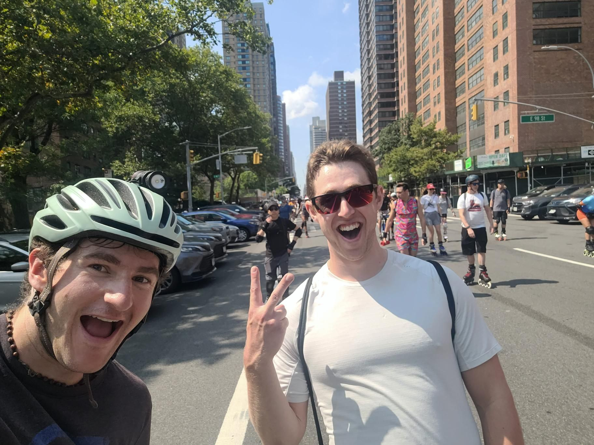

+++
title = "Mega mega skate"
description = "InlineSkate — 2025-08-02"
date = 2025-08-02
authors = ["Max Katz-Christy"]

[taxonomies]
tags = ["InlineSkate"]

[extra]
banner = "banner.jpg"
strava_id = 15323388204
distance_fmt = "63.49 km"
moving_time_fmt = "4h 46m 15s"
elevation_gain_fmt = "533 m"
+++

Mostly the mega skate but 2 park laps with Maela Whitcomb when she finally woke up

## Stats

| | |
|---|---|
| **Distance** | 63.49 km |
| **Moving time** | 4h 46m 15s |
| **Elapsed time** | 6h 52m 41s |
| **Elevation gain** | 533 m |
| **Average speed** | 13.3 km/h |
| **Max speed** | 49.0 km/h |
| **Calories** | 2711 kcal |
| **Achievements** | 341 |
| **Device** | Garmin fēnix 6X |

## Route

{{ strava_map() }}

[View on Strava](https://www.strava.com/activities/15323388204)

## Photos

