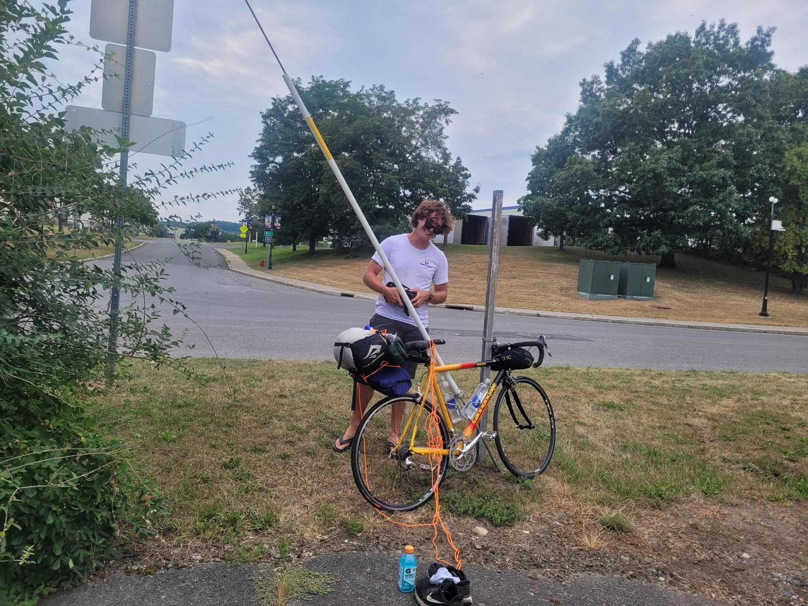

+++
title = "Maybe I should have slept more than 1h before starting..."
description = "Ride — 2025-08-17"
date = 2025-08-17
authors = ["Max Katz-Christy"]

[taxonomies]
tags = ["Ride"]

[extra]
banner = "banner.jpg"
strava_id = 15507001190
distance_fmt = "349.30 km"
moving_time_fmt = "17h 31m 50s"
elevation_gain_fmt = "829 m"
+++

Meeting up with Julius who I had dropped off in Albany. We were running late so I slowly drove west to Buffalo, napping at every other rest stop for 7-10 mins and then taking a full hour nap before packing and going. I've never been so tired biking (actually once with Maks doing another double century overnight thing).

My performance was quite poor... I think primarily due to lack of sleep. I gotta work on that. While riding, I napped a couple times for 10 minutes and 1h after nodding off at the wheel.

The trail is fun though. It's not monotonous, surprisingly. I'll get more pictures on the way back 😀

## Stats

| | |
|---|---|
| **Distance** | 349.30 km |
| **Moving time** | 17h 31m 50s |
| **Elapsed time** | 20h 59m 17s |
| **Elevation gain** | 829 m |
| **Average speed** | 19.9 km/h |
| **Max speed** | 44.7 km/h |
| **Average cadence** | 67 rpm |
| **Average power** | 117 W |
| **Weighted avg power** | 122 W |
| **Energy** | 7312 kJ |
| **Calories** | 9252 kcal |
| **Device** | Garmin fēnix 6X |

## Route

{{ strava_map() }}

[View on Strava](https://www.strava.com/activities/15507001190)

## Photos

