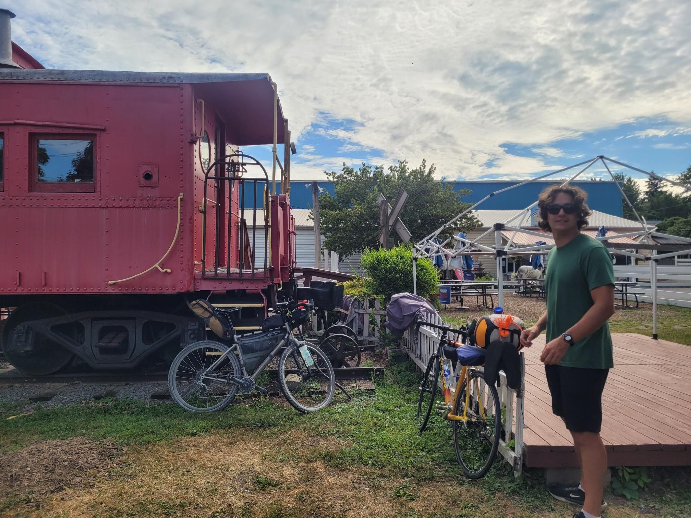

+++
title = "On the way back with Julius"
description = "Ride — 2025-08-19"
date = 2025-08-19
authors = ["Max Katz-Christy"]

[taxonomies]
tags = ["Ride"]

[extra]
banner = "banner.jpg"
strava_id = 15518278617
distance_fmt = "135.01 km"
moving_time_fmt = "6h 38m 53s"
elevation_gain_fmt = "428 m"
+++

I'm tired... And it's raining. Just made a tinder profile to find a place to sleep. Waiting at Taco Bell until then

## Stats

| | |
|---|---|
| **Distance** | 135.01 km |
| **Moving time** | 6h 38m 53s |
| **Elapsed time** | 8h 20m 33s |
| **Elevation gain** | 428 m |
| **Average speed** | 20.3 km/h |
| **Max speed** | 51.7 km/h |
| **Average cadence** | 63 rpm |
| **Average power** | 118 W |
| **Weighted avg power** | 132 W |
| **Energy** | 2757 kJ |
| **Calories** | 3470 kcal |
| **Device** | Garmin fēnix 6X |

## Route

{{ strava_map() }}

[View on Strava](https://www.strava.com/activities/15518278617)

## Photos

