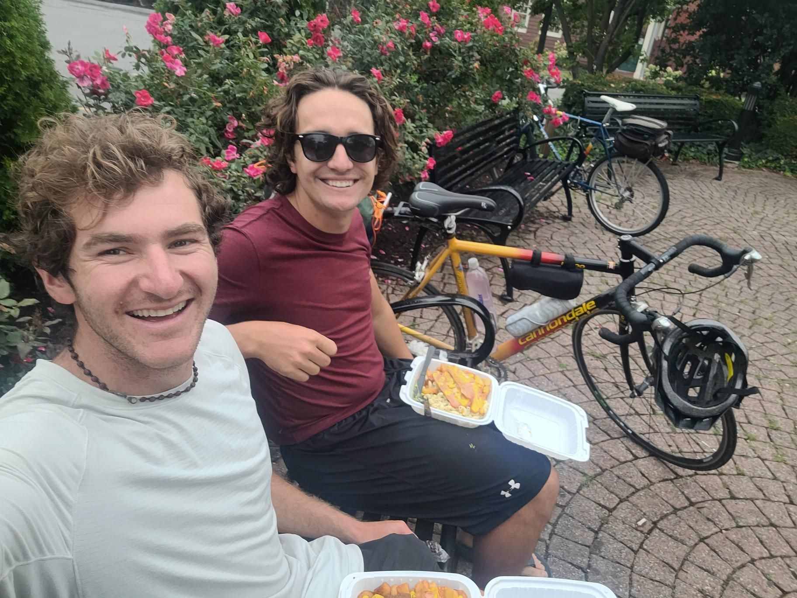

+++
title = "Rain day rest day!"
description = "Ride — 2025-08-20"
date = 2025-08-20
authors = ["Max Katz-Christy"]

[taxonomies]
tags = ["Ride"]

[extra]
banner = "banner.jpg"
strava_id = 15529671027
distance_fmt = "66.52 km"
moving_time_fmt = "3h 39m 57s"
elevation_gain_fmt = "161 m"
+++

Took our sweet time. Maybe a little too sweet... Missed the welcome center by a few minutes

## Stats

| | |
|---|---|
| **Distance** | 66.52 km |
| **Moving time** | 3h 39m 57s |
| **Elapsed time** | 5h 15m 17s |
| **Elevation gain** | 161 m |
| **Average speed** | 18.1 km/h |
| **Max speed** | 32.1 km/h |
| **Average cadence** | 59 rpm |
| **Average power** | 98 W |
| **Weighted avg power** | 105 W |
| **Energy** | 1286 kJ |
| **Calories** | 1765 kcal |
| **Device** | Garmin fēnix 6X |

## Route

{{ strava_map() }}

[View on Strava](https://www.strava.com/activities/15529671027)

## Photos

