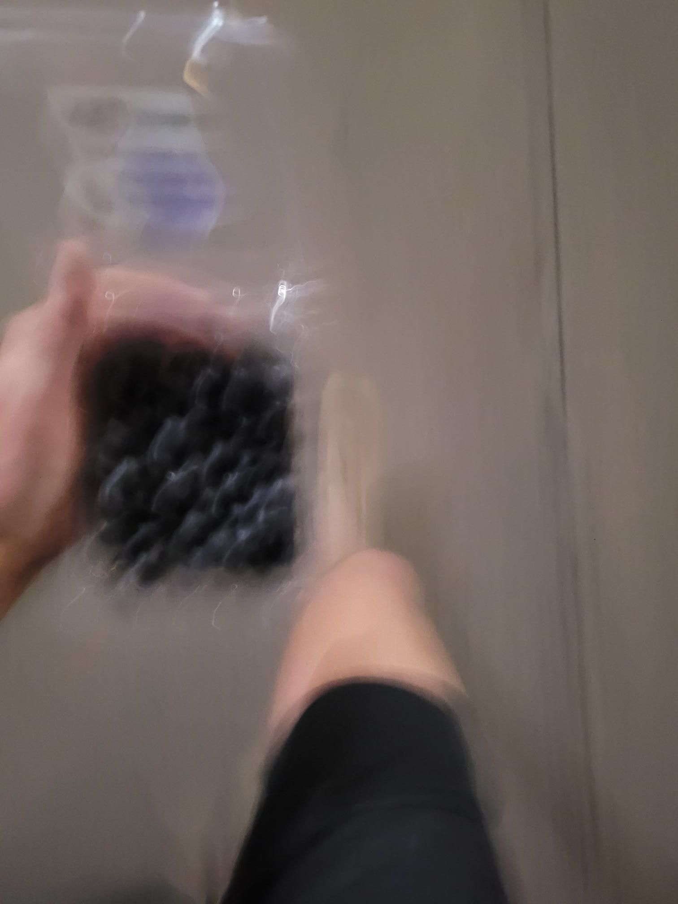

+++
title = "The lengths I go to for a highly rated too good to go..."
description = "Run — 2025-08-31"
date = 2025-08-31
authors = ["Max Katz-Christy"]

[taxonomies]
tags = ["Run"]

[extra]
banner = "banner.jpg"
strava_id = 15654881445
distance_fmt = "21.55 km"
moving_time_fmt = "1h 52m 48s"
elevation_gain_fmt = "112 m"
+++

Also picked up a banana and some blueberries and downed them between miles 9 and 11. Running with a container of blueberries is fine, running with a bag of jerk chicken is harder. Ended at the too good to go from the gooiest cookies in nyc. Unfortunately that means I have basically half baked cookie dough 🤔

## Stats

| | |
|---|---|
| **Distance** | 21.55 km |
| **Moving time** | 1h 52m 48s |
| **Elapsed time** | 2h 02m 22s |
| **Elevation gain** | 112 m |
| **Average pace** | 5:14 /km |
| **Best pace** | 0:53 /km |
| **Average cadence** | 80 rpm |
| **Calories** | 1414 kcal |
| **Achievements** | 14 |
| **Device** | Garmin fēnix 6X |

## Route

{{ strava_map() }}

[View on Strava](https://www.strava.com/activities/15654881445)

## Photos

