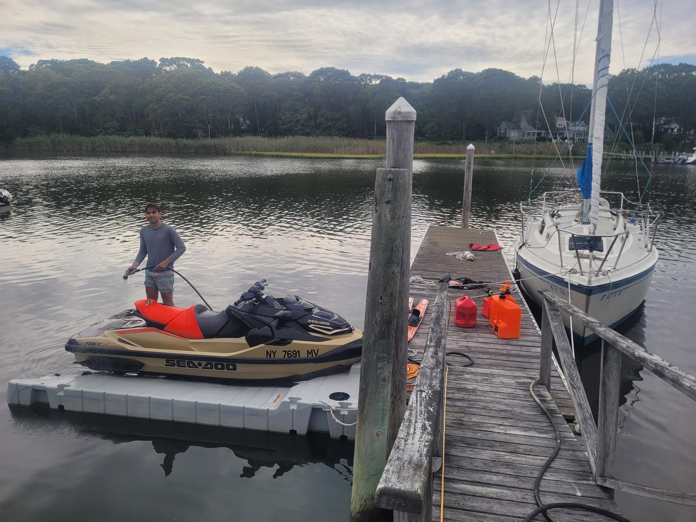

+++
title = "Finally figured out how to waterski on one ski!!"
description = "Sail — 2025-09-01"
date = 2025-09-01
authors = ["Max Katz-Christy"]

[taxonomies]
tags = ["Sail"]

[extra]
banner = "banner.jpg"
strava_id = 15663196459
distance_fmt = "10.08 km"
moving_time_fmt = "13m 36s"
elevation_gain_fmt = "10 m"
+++

Met the parents, and the grandparents. Big day. I'm gonna sleep well on my flight tn

## Stats

| | |
|---|---|
| **Distance** | 10.08 km |
| **Moving time** | 13m 36s |
| **Elapsed time** | 13m 36s |
| **Elevation gain** | 10 m |
| **Average speed** | 44.5 km/h |
| **Max speed** | 83.2 km/h |
| **Average cadence** | 23 rpm |
| **Calories** | 2321 kcal |
| **Device** | Garmin fēnix 6X |

## Route

{{ strava_map() }}

[View on Strava](https://www.strava.com/activities/15663196459)

## Photos

