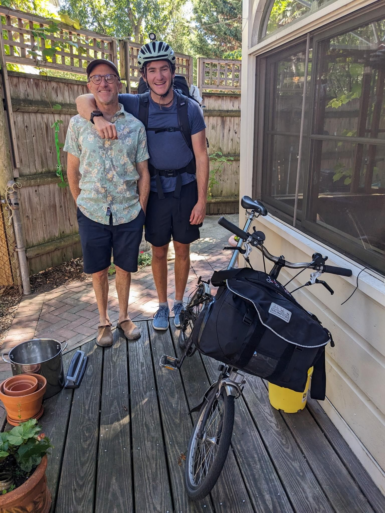

+++
title = "It wasn't clear how to exit the airport by bike"
description = "Ride — 2025-09-02"
date = 2025-09-02
authors = ["Max Katz-Christy"]

[taxonomies]
tags = ["Ride"]

[extra]
banner = "banner.jpg"
strava_id = 15671861083
distance_fmt = "39.84 km"
moving_time_fmt = "2h 23m 19s"
elevation_gain_fmt = "239 m"
+++

They did have many train options, and at every uphill I questioned my decision

## Stats

| | |
|---|---|
| **Distance** | 39.84 km |
| **Moving time** | 2h 23m 19s |
| **Elapsed time** | 2h 40m 23s |
| **Elevation gain** | 239 m |
| **Average speed** | 16.7 km/h |
| **Max speed** | 43.3 km/h |
| **Calories** | 937 kcal |
| **Device** | Garmin fēnix 6X |

## Route

{{ strava_map() }}

[View on Strava](https://www.strava.com/activities/15671861083)

## Photos

