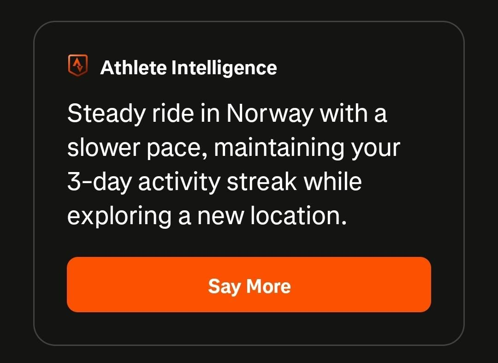

+++
title = "So excited to sleep on the bus"
description = "Ride — 2025-09-02"
date = 2025-09-02
authors = ["Max Katz-Christy"]

[taxonomies]
tags = ["Ride"]

[extra]
banner = "banner.jpg"
strava_id = 15673819079
distance_fmt = "22.58 km"
moving_time_fmt = "1h 31m 06s"
elevation_gain_fmt = "213 m"
+++

Short day, but busy and stressful. I did all of the stressing and planning that most people do before departure upon arrival.

Many questions were directed at my mom and chat gpt... each were helpful in their own way. Chat just doesn't have the same sympathy as my human mother and hearing "Wow, your correction to my last statement was SO right! That's a great idea!" somehow makes chat feel even further removed from reality.

PS: the Strava AI is shitting on my speed without accounting for the picture where it is obvious that I'm carrying my life on the front of a Brompton 🤔

## Stats

| | |
|---|---|
| **Distance** | 22.58 km |
| **Moving time** | 1h 31m 06s |
| **Elapsed time** | 1h 40m 28s |
| **Elevation gain** | 213 m |
| **Average speed** | 14.9 km/h |
| **Max speed** | 41.6 km/h |
| **Calories** | 606 kcal |
| **Device** | Garmin fēnix 6X |

## Route

{{ strava_map() }}

[View on Strava](https://www.strava.com/activities/15673819079)

## Photos

