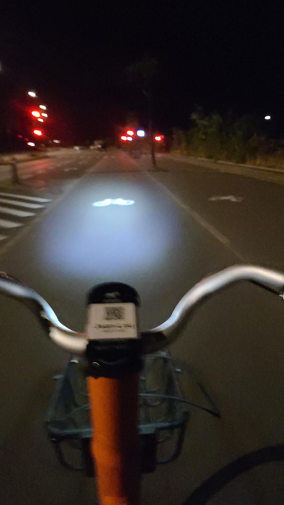

+++
title = "Still getting used to the new time zone"
description = "Ride — 2025-09-03"
date = 2025-09-03
authors = ["Max Katz-Christy"]

[taxonomies]
tags = ["Ride"]

[extra]
banner = "banner.jpg"
strava_id = 15688905742
distance_fmt = "25.94 km"
moving_time_fmt = "1h 31m 01s"
elevation_gain_fmt = "69 m"
+++

Moved into my new place! Took a fantastic nap after spending two nights in transit. Went to a meetup at bar and met a bunch of people. Was not feeling super tired after, and I wanted to burn more of the 2h left on my daily donkey bike allowance, so went up along the shore, flying downwind. Then I trudged back home

## Stats

| | |
|---|---|
| **Distance** | 25.94 km |
| **Moving time** | 1h 31m 01s |
| **Elapsed time** | 1h 41m 26s |
| **Elevation gain** | 69 m |
| **Average speed** | 17.1 km/h |
| **Max speed** | 36.5 km/h |
| **Calories** | 620 kcal |
| **Device** | Garmin fēnix 6X |

## Route

{{ strava_map() }}

[View on Strava](https://www.strava.com/activities/15688905742)

## Photos

