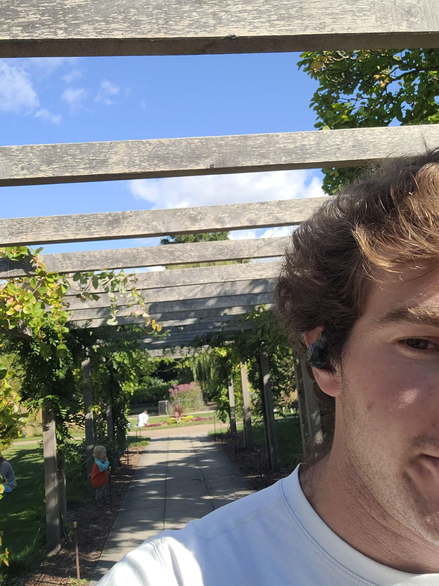

+++
title = "\"They grow by the S train\""
description = "Run — 2025-09-06"
date = 2025-09-06
authors = ["Max Katz-Christy"]

[taxonomies]
tags = ["Run"]

[extra]
banner = "banner.jpg"
strava_id = 15717667748
distance_fmt = "5.37 km"
moving_time_fmt = "34m 11s"
elevation_gain_fmt = "20 m"
+++

Found blackberries! Not many ripe ones, and I can't tell if I'm early or late.

You can really do a beer garden here. Like you can actually have beer in a garden.

## Stats

| | |
|---|---|
| **Distance** | 5.37 km |
| **Moving time** | 34m 11s |
| **Elapsed time** | 40m 18s |
| **Elevation gain** | 20 m |
| **Average pace** | 6:22 /km |
| **Best pace** | 3:28 /km |
| **Average cadence** | 75 rpm |
| **Calories** | 417 kcal |
| **Device** | Garmin fēnix 6X |

## Route

{{ strava_map() }}

[View on Strava](https://www.strava.com/activities/15717667748)

## Photos

