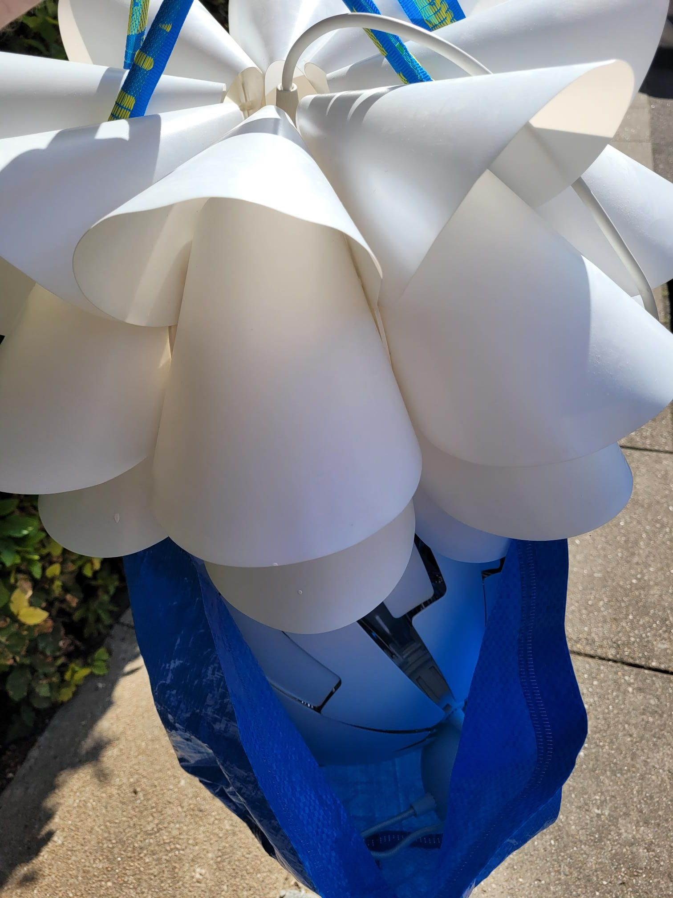

+++
title = "Facebook Marketplace lamp fetching"
description = "Ride — 2025-09-07"
date = 2025-09-07
authors = ["Max Katz-Christy"]

[taxonomies]
tags = ["Ride"]

[extra]
banner = "banner.jpg"
strava_id = 15726672245
distance_fmt = "12.92 km"
moving_time_fmt = "47m 56s"
elevation_gain_fmt = "49 m"
+++

I got two offers and they both wanted danish kroner cash, so I told one that I didn't have cash and I got cash to buy the other one. But then the one I lied to said I could have it for free. So now I've got two. Hopefully one works.

It was interesting biking along with an Ikea bag with lamps in it on my donkey republic upright bike, getting passed by intense Danish cyclists, fully kitted in rapha ready to hold onto the provided post at the next red light so they don't have to unclip.

I wonder how long these croissants will be good for... I might have just finished the last chocolate one. They are getting a bit harder.

## Stats

| | |
|---|---|
| **Distance** | 12.92 km |
| **Moving time** | 47m 56s |
| **Elapsed time** | 1h 08m 01s |
| **Elevation gain** | 49 m |
| **Average speed** | 16.2 km/h |
| **Max speed** | 29.1 km/h |
| **Calories** | 415 kcal |
| **Device** | Garmin fēnix 6X |

## Route

{{ strava_map() }}

[View on Strava](https://www.strava.com/activities/15726672245)

## Photos

