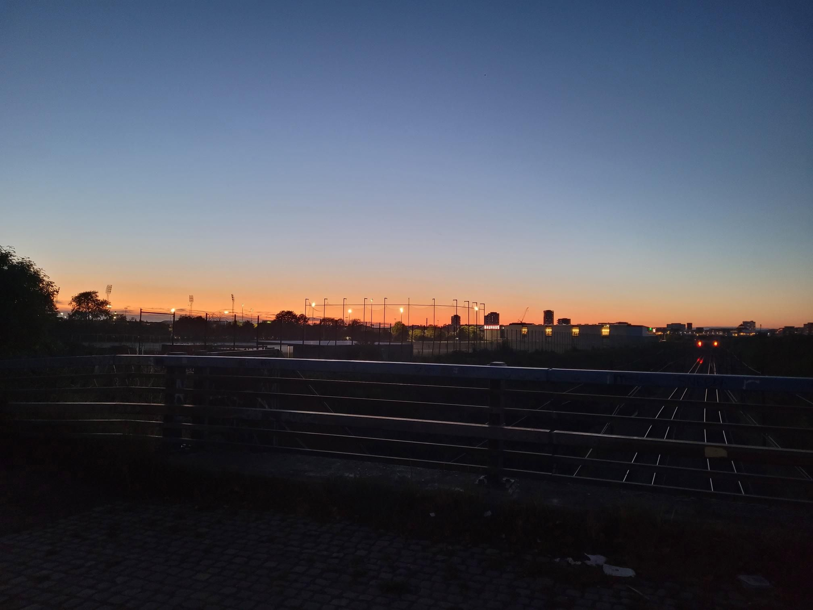

+++
title = "It almost looks like a bridge loop 😬"
description = "Run — 2025-09-10"
date = 2025-09-10
authors = ["Max Katz-Christy"]

[taxonomies]
tags = ["Run"]

[extra]
banner = "banner.jpg"
strava_id = 15765529375
distance_fmt = "7.12 km"
moving_time_fmt = "38m 42s"
elevation_gain_fmt = "33 m"
+++

MRC Wednesday. Still very sore from CrossFit with my boss, not sure if this hurt or helped.

Went to some museums with some abroad program people, which was a good reminder of why I don't go to museums. I get really tired, sleepy, hungry, and thirsty. They are free this week, but some free things are not so free and I paid for it in being really sleepy. 

I joined a frisbee club! I also did my laundry! They have machines that auto add soap here. Pretty fancy. No coin operated crap here

## Stats

| | |
|---|---|
| **Distance** | 7.12 km |
| **Moving time** | 38m 42s |
| **Elapsed time** | 40m 18s |
| **Elevation gain** | 33 m |
| **Average pace** | 5:26 /km |
| **Best pace** | 2:43 /km |
| **Average cadence** | 79 rpm |
| **Calories** | 523 kcal |
| **Achievements** | 1 |
| **Device** | Garmin fēnix 6X |

## Route

{{ strava_map() }}

[View on Strava](https://www.strava.com/activities/15765529375)

## Photos

