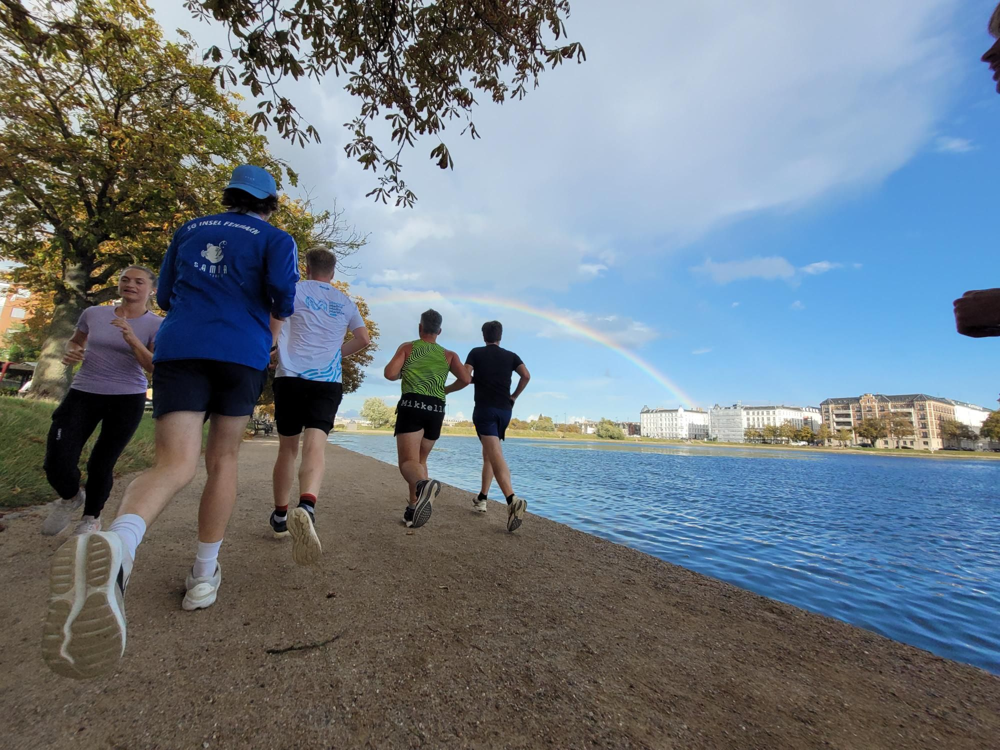

+++
title = "Mid Friday Bar Run"
description = "Run — 2025-09-12"
date = 2025-09-12
authors = ["Max Katz-Christy"]

[taxonomies]
tags = ["Run"]

[extra]
banner = "banner.jpg"
strava_id = 15787371426
distance_fmt = "8.79 km"
moving_time_fmt = "52m 00s"
elevation_gain_fmt = "20 m"
+++

I left free drinks, foosball, and ping pong at work to go running at the last minute and had to run to catch up to the group.

I was planning on coming back to work to just grab my bag and go home to change for Friday Night Skate, but got distracted because people were still at Friday Bar. So I drank more, lost foosball, and went out with people from some other startup! Plus, it was raining so I feel like that was a decent excuse to miss FNS.

Also check out my TGTG sushi haul 🚄

## Stats

| | |
|---|---|
| **Distance** | 8.79 km |
| **Moving time** | 52m 00s |
| **Elapsed time** | 1h 03m 56s |
| **Elevation gain** | 20 m |
| **Average pace** | 5:54 /km |
| **Best pace** | 3:37 /km |
| **Average cadence** | 78 rpm |
| **Calories** | 673 kcal |
| **Achievements** | 3 |
| **Device** | Garmin fēnix 6X |

## Route

{{ strava_map() }}

[View on Strava](https://www.strava.com/activities/15787371426)

## Photos

