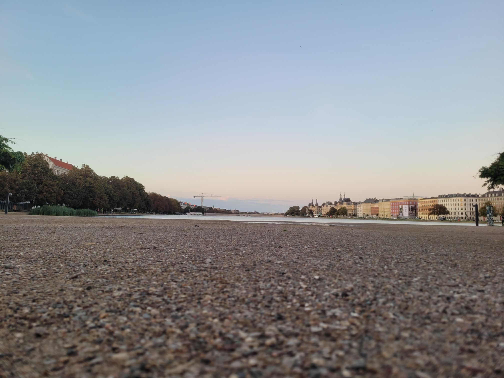

+++
title = "It looks almost like I got lost on my way home"
description = "Run — 2025-09-16"
date = 2025-09-16
authors = ["Max Katz-Christy"]

[taxonomies]
tags = ["Run"]

[extra]
banner = "banner.jpg"
strava_id = 15834147974
distance_fmt = "9.79 km"
moving_time_fmt = "1h 00m 54s"
elevation_gain_fmt = "32 m"
+++

I got lost on my way home. I was gonna pick up a tgtg on the way (high rating) but the description said it was at the airport and you need a boarding pass, so I didn't buy it until I got there.

It was sold out when I got there. Also I had been checking it so much that my phone was on 1%. To keep my music running, I turned my phone on airplane mode and didn't touch it. Plus, how lost could I get?

I did find the road in the end, it's a pretty straight shot once I'm on it, but the street signage is not very strong here.

## Stats

| | |
|---|---|
| **Distance** | 9.79 km |
| **Moving time** | 1h 00m 54s |
| **Elapsed time** | 1h 09m 38s |
| **Elevation gain** | 32 m |
| **Average pace** | 6:13 /km |
| **Best pace** | 2:04 /km |
| **Average cadence** | 75 rpm |
| **Calories** | 696 kcal |
| **Achievements** | 4 |
| **Device** | Garmin fēnix 6X |

## Route

{{ strava_map() }}

[View on Strava](https://www.strava.com/activities/15834147974)

## Photos

