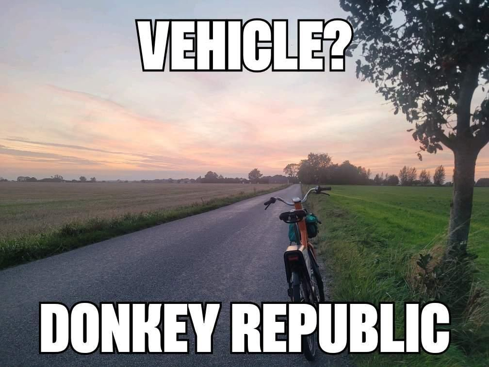

+++
title = "Probably easier than a bluebike/citibike"
description = "Ride — 2025-09-19"
date = 2025-09-19
authors = ["Max Katz-Christy"]

[taxonomies]
tags = ["Ride"]

[extra]
banner = "banner.jpg"
strava_id = 15870200787
distance_fmt = "194.60 km"
moving_time_fmt = "10h 00m 22s"
elevation_gain_fmt = "814 m"
+++

It was 2:30pm and I was feeling like I should get out and do something. I had noticed that there were a set of donkey bikes really far south... So I was tentatively going to circumnavigate the network. However, when I got close, I noticed they were no longer on the map! Apparently they're in a different network. At some point I'll have to do a proper circumnavigation, but it looks like it'll be easier than I thought.

## Stats

| | |
|---|---|
| **Distance** | 194.60 km |
| **Moving time** | 10h 00m 22s |
| **Elapsed time** | 11h 15m 57s |
| **Elevation gain** | 814 m |
| **Average speed** | 19.4 km/h |
| **Max speed** | 36.5 km/h |
| **Calories** | 3863 kcal |
| **Device** | Garmin fēnix 6X |

## Route

{{ strava_map() }}

[View on Strava](https://www.strava.com/activities/15870200787)

## Photos

