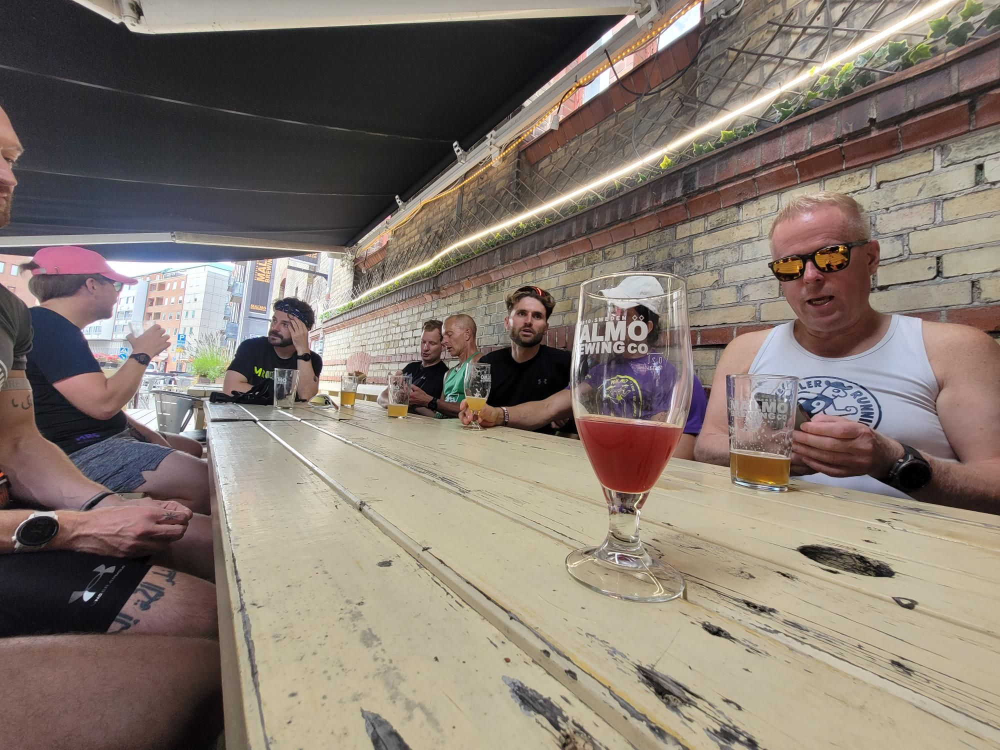

+++
title = "MRC Malmö"
description = "Run — 2025-09-20"
date = 2025-09-20
authors = ["Max Katz-Christy"]

[taxonomies]
tags = ["Run"]

[extra]
banner = "banner.jpg"
strava_id = 15877722601
distance_fmt = "11.75 km"
moving_time_fmt = "1h 49m 28s"
elevation_gain_fmt = "65 m"
+++

Lots of drinking and a little bit of running. And a too good to go in the middle with Jens Christian Ytre-Arne 

I'm about to pick up my second swedish too good to go now (falafel in between was great but I still need one more burrito to fall asleep on the train back).

## Stats

| | |
|---|---|
| **Distance** | 11.75 km |
| **Moving time** | 1h 49m 28s |
| **Elapsed time** | 3h 22m 24s |
| **Elevation gain** | 65 m |
| **Average pace** | 9:18 /km |
| **Best pace** | 3:10 /km |
| **Average cadence** | 76 rpm |
| **Calories** | 879 kcal |
| **Device** | Garmin fēnix 6X |

## Route

{{ strava_map() }}

[View on Strava](https://www.strava.com/activities/15877722601)

## Photos

