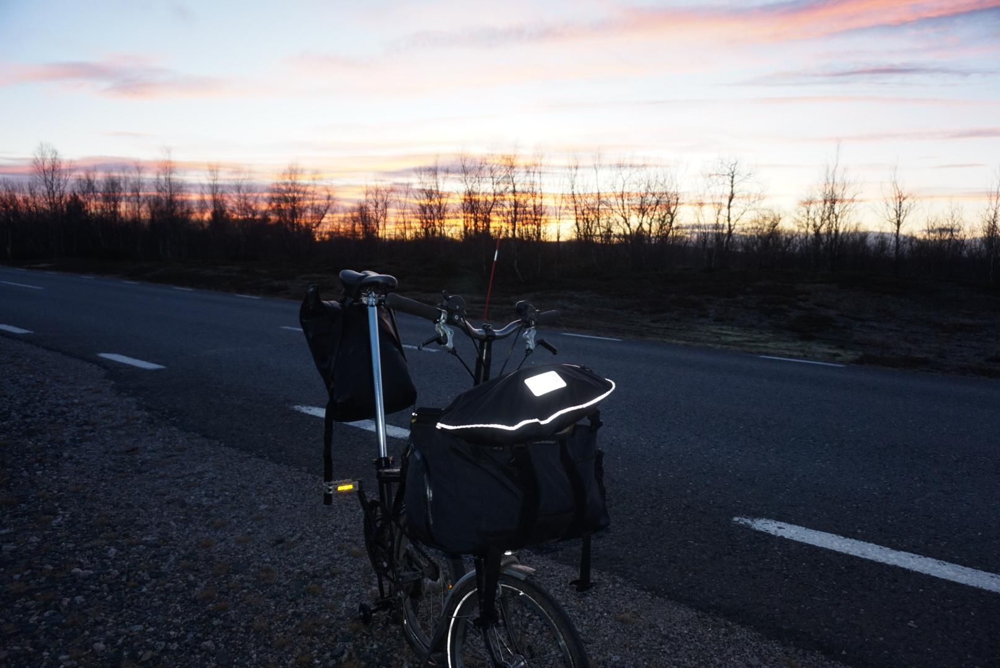

+++
title = "A renewed respect for wood stoves"
description = "Ride — 2025-10-16"
date = 2025-10-16
authors = ["Max Katz-Christy"]

[taxonomies]
tags = ["Ride"]

[extra]
banner = "banner.jpg"
strava_id = 16168093053
distance_fmt = "70.81 km"
moving_time_fmt = "4h 17m 24s"
elevation_gain_fmt = "384 m"
+++

Open fire pits are really challenging. I biked to this open cabin in the woods. It was very nice, with half the building being a small barn. Temperatures were to drop below freezing that night and I only had a pad and a sleeping bag liner because I hadn't really planned on camping. I smoked the place out with sticks I had collected and then kinda freaked and bailed (see next ride).

## Stats

| | |
|---|---|
| **Distance** | 70.81 km |
| **Moving time** | 4h 17m 24s |
| **Elapsed time** | 4h 50m 50s |
| **Elevation gain** | 384 m |
| **Average speed** | 16.5 km/h |
| **Max speed** | 28.8 km/h |
| **Calories** | 2027 kcal |
| **Device** | Garmin fēnix 6X |

## Route

{{ strava_map() }}

[View on Strava](https://www.strava.com/activities/16168093053)

## Photos

