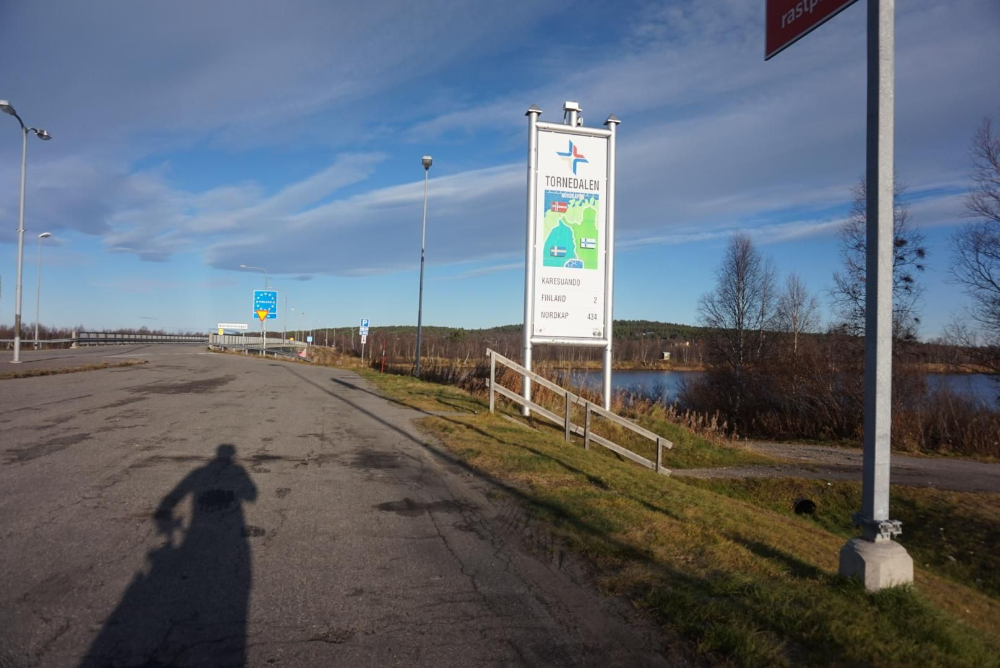

+++
title = "Crossing the Finnish line"
description = "Ride — 2025-10-17"
date = 2025-10-17
authors = ["Max Katz-Christy"]

[taxonomies]
tags = ["Ride"]

[extra]
banner = "banner.jpg"
strava_id = 16168142387
distance_fmt = "30.10 km"
moving_time_fmt = "1h 44m 16s"
elevation_gain_fmt = "106 m"
+++

I waited a while to use this one haha. Janie K-C did I get the spelling right this time? 

I'm looking forward to being in hostels and on trains! While a little bit less exciting, it's a little more relaxing.

## Stats

| | |
|---|---|
| **Distance** | 30.10 km |
| **Moving time** | 1h 44m 16s |
| **Elapsed time** | 2h 18m 37s |
| **Elevation gain** | 106 m |
| **Average speed** | 17.3 km/h |
| **Max speed** | 30.7 km/h |
| **Calories** | 988 kcal |
| **Device** | Garmin fēnix 6X |

## Route

{{ strava_map() }}

[View on Strava](https://www.strava.com/activities/16168142387)

## Photos

