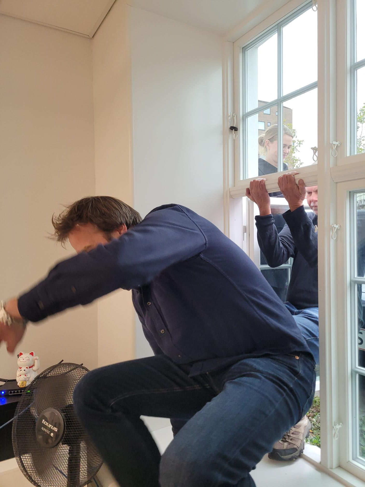

+++
title = "Back home!"
description = "Run — 2025-10-22"
date = 2025-10-22
authors = ["Max Katz-Christy"]

[taxonomies]
tags = ["Run"]

[extra]
banner = "banner.jpg"
strava_id = 16225327650
distance_fmt = "7.46 km"
moving_time_fmt = "45m 59s"
elevation_gain_fmt = "44 m"
+++

Plus some complimentary photos of my company returning to the office after the fire alarm as well as my night out in Stockholm with Dave Connelly's friend.

## Stats

| | |
|---|---|
| **Distance** | 7.46 km |
| **Moving time** | 45m 59s |
| **Elapsed time** | 55m 53s |
| **Elevation gain** | 44 m |
| **Average pace** | 6:10 /km |
| **Best pace** | 2:51 /km |
| **Average cadence** | 75 rpm |
| **Calories** | 555 kcal |
| **Achievements** | 3 |
| **Device** | Garmin fēnix 6X |

## Route

{{ strava_map() }}

[View on Strava](https://www.strava.com/activities/16225327650)

## Photos

