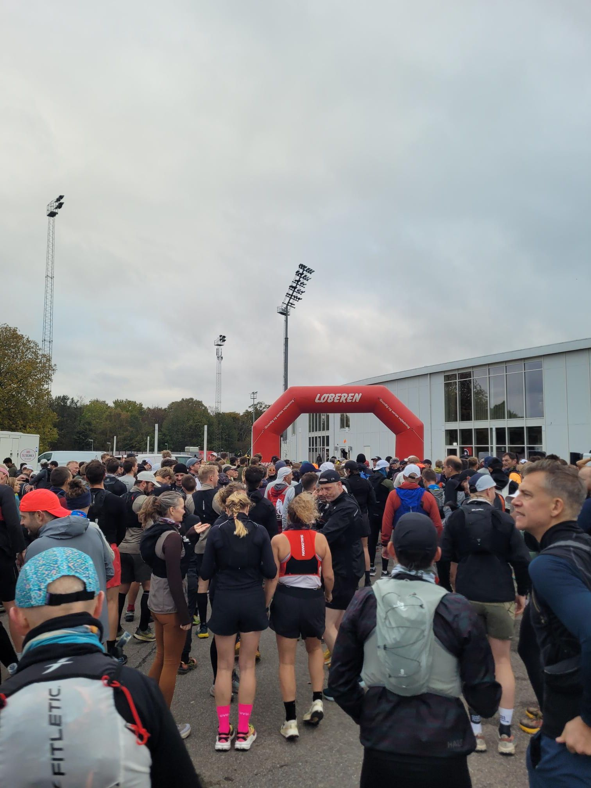

+++
title = "Everyone on the train had those strange little trail runner hats"
description = "TrailRun — 2025-10-25"
date = 2025-10-25
authors = ["Max Katz-Christy"]

[taxonomies]
tags = ["TrailRun"]

[extra]
banner = "banner.jpg"
strava_id = 16249381511
distance_fmt = "29.94 km"
moving_time_fmt = "2h 27m 41s"
elevation_gain_fmt = "338 m"
+++

At least I knew I was on the right train. And I didn't have to navigate to the start, just follow the bikes. And then chat with the bikes and make friends with the bikes. And then make friends with the bikes friends

Met some fun folks on the train back too!! Then got myself some niiice tgtg

## Stats

| | |
|---|---|
| **Distance** | 29.94 km |
| **Moving time** | 2h 27m 41s |
| **Elapsed time** | 2h 28m 08s |
| **Elevation gain** | 338 m |
| **Average pace** | 4:55 /km |
| **Best pace** | 2:57 /km |
| **Average cadence** | 83 rpm |
| **Calories** | 2056 kcal |
| **Device** | Garmin fēnix 6X |

## Route

{{ strava_map() }}

[View on Strava](https://www.strava.com/activities/16249381511)

## Photos

