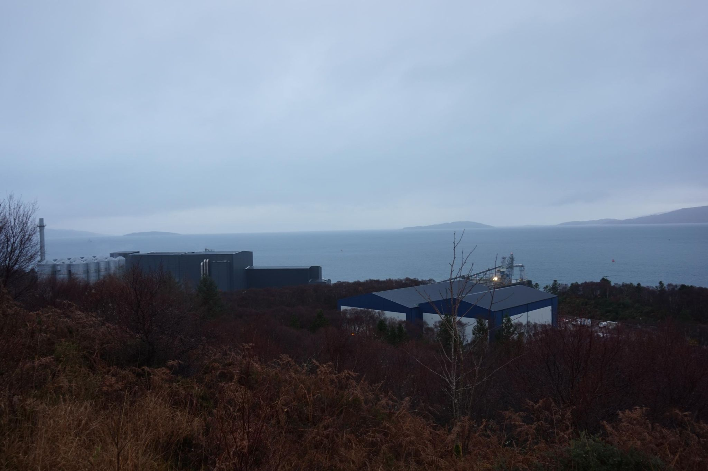

+++
title = "Industry hidden in nature"
description = "TrailRun — 2025-11-18"
date = 2025-11-18
authors = ["Max Katz-Christy"]

[taxonomies]
tags = ["TrailRun"]

[extra]
banner = "banner.jpg"
strava_id = 16492546364
distance_fmt = "3.32 km"
moving_time_fmt = "24m 07s"
elevation_gain_fmt = "128 m"
+++

It's so easy to pretend it's not there. Generally, they keep away from the super touristy spots. But from a lesser known trail, you can see behind the curtain of trees to the big industrial buildings and the surrounding parking lots. There are more subtle signs as well: logged trees, rusty metal items, portholed dirt roles. Is tourism really any better though? Or does it just pay for the masking of what's really there.

## Stats

| | |
|---|---|
| **Distance** | 3.32 km |
| **Moving time** | 24m 07s |
| **Elapsed time** | 28m 05s |
| **Elevation gain** | 128 m |
| **Average pace** | 7:15 /km |
| **Best pace** | 3:59 /km |
| **Average cadence** | 73 rpm |
| **Calories** | 290 kcal |
| **Device** | Garmin fēnix 6X |

## Route

{{ strava_map() }}

[View on Strava](https://www.strava.com/activities/16492546364)

## Photos

