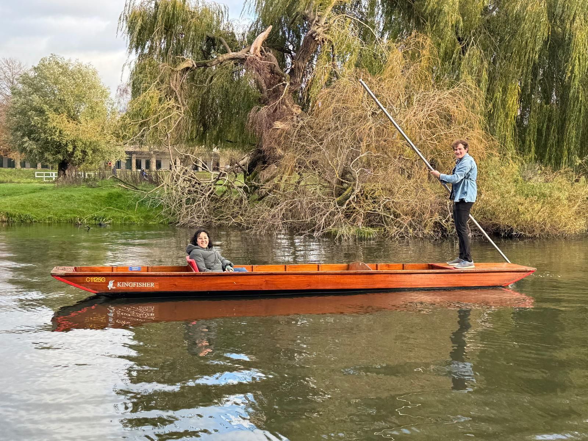

+++
title = "Off-season punting"
description = "StandUpPaddling — 2025-11-23"
date = 2025-11-23
authors = ["Max Katz-Christy"]

[taxonomies]
tags = ["StandUpPaddling"]

[extra]
banner = "banner.jpg"
strava_id = 16545283684
distance_fmt = "1.26 km"
moving_time_fmt = "23m 39s"
elevation_gain_fmt = "3 m"
+++

And early Friendsgiving!

## Stats

| | |
|---|---|
| **Distance** | 1.26 km |
| **Moving time** | 23m 39s |
| **Elapsed time** | 30m 06s |
| **Elevation gain** | 3 m |
| **Average speed** | 3.2 km/h |
| **Max speed** | 15.4 km/h |
| **Average cadence** | 31 rpm |
| **Calories** | 129 kcal |
| **Device** | Garmin fēnix 6X |

## Route

{{ strava_map() }}

[View on Strava](https://www.strava.com/activities/16545283684)

## Photos

