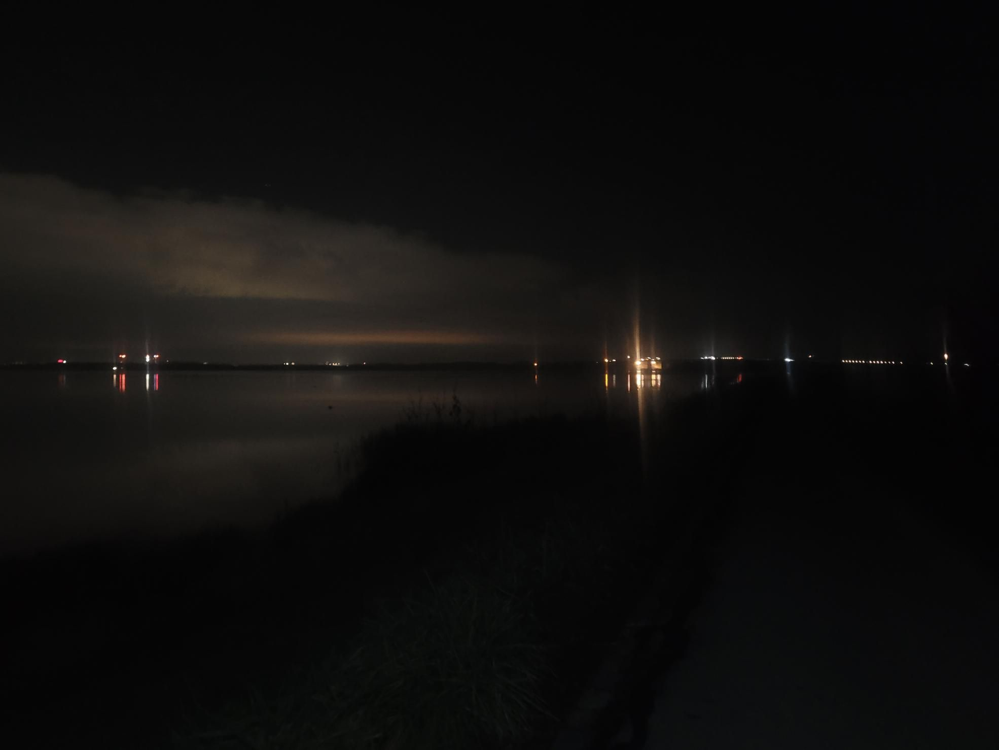

+++
title = "Spookin the Amager deer"
description = "InlineSkate — 2025-11-26"
date = 2025-11-26
authors = ["Max Katz-Christy"]

[taxonomies]
tags = ["InlineSkate"]

[extra]
banner = "banner.jpg"
strava_id = 16577939791
distance_fmt = "35.96 km"
moving_time_fmt = "2h 33m 58s"
elevation_gain_fmt = "94 m"
+++

Unusual to see the water so still, but very pretty. The deer were a bit confused to see me. I could see my breath very easily. Then all of a sudden I entered the fog and couldn't see much at all. I meant to leave well before midnight, but...

## Stats

| | |
|---|---|
| **Distance** | 35.96 km |
| **Moving time** | 2h 33m 58s |
| **Elapsed time** | 2h 40m 15s |
| **Elevation gain** | 94 m |
| **Average speed** | 14.0 km/h |
| **Max speed** | 32.6 km/h |
| **Calories** | 1093 kcal |
| **Achievements** | 2 |
| **Device** | Garmin fēnix 6X |

## Route

{{ strava_map() }}

[View on Strava](https://www.strava.com/activities/16577939791)

## Photos

