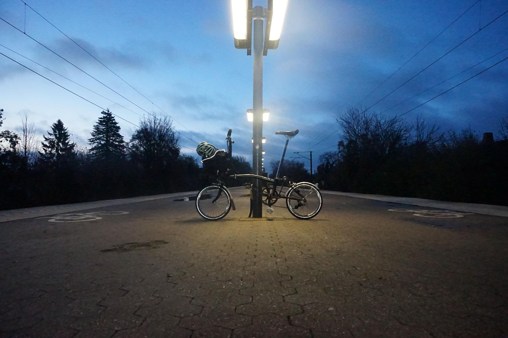

+++
title = "Back with the Brompton in Sweden!"
description = "Ride — 2025-11-29"
date = 2025-11-29
authors = ["Max Katz-Christy"]

[taxonomies]
tags = ["Ride"]

[extra]
banner = "banner.jpg"
strava_id = 16600794490
distance_fmt = "13.00 km"
moving_time_fmt = "55m 26s"
elevation_gain_fmt = "118 m"
+++

Nursing two low tires, didn't find a pump along the way. Still rode fine.

## Stats

| | |
|---|---|
| **Distance** | 13.00 km |
| **Moving time** | 55m 26s |
| **Elapsed time** | 1h 00m 01s |
| **Elevation gain** | 118 m |
| **Average speed** | 14.1 km/h |
| **Max speed** | 30.5 km/h |
| **Calories** | 433 kcal |
| **Device** | Garmin fēnix 6X |

## Route

{{ strava_map() }}

[View on Strava](https://www.strava.com/activities/16600794490)

## Photos

