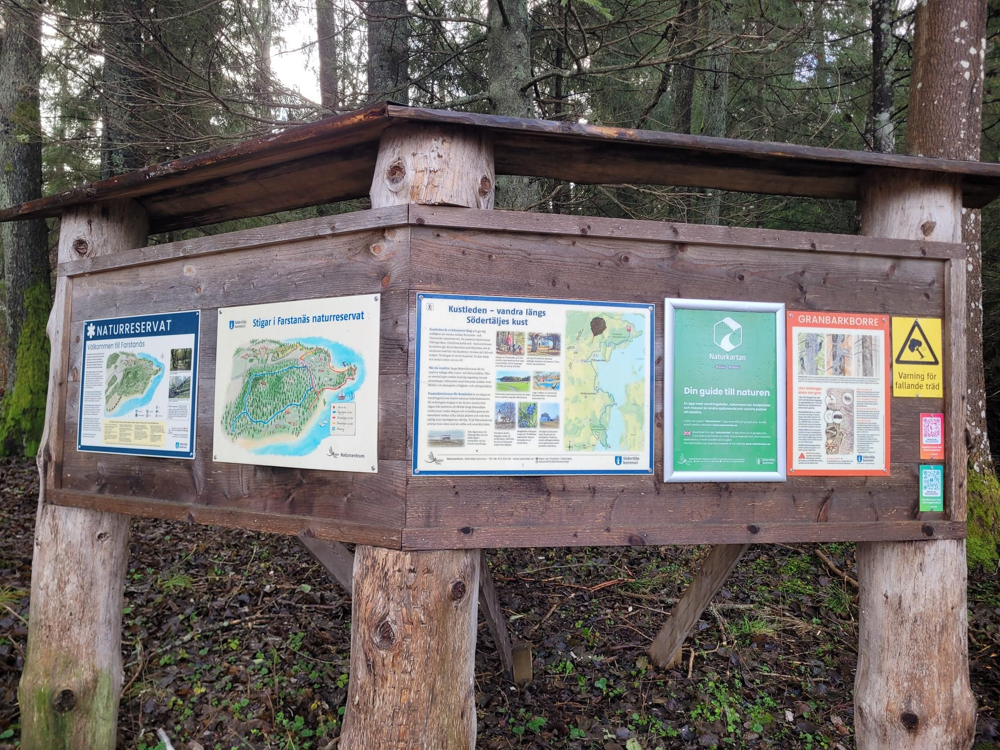

+++
title = "Between an electric fence and an irrigation ditch"
description = "TrailRun — 2025-12-01"
date = 2025-12-01
authors = ["Max Katz-Christy"]

[taxonomies]
tags = ["TrailRun"]

[extra]
banner = "banner.jpg"
strava_id = 16617751052
distance_fmt = "13.35 km"
moving_time_fmt = "1h 26m 49s"
elevation_gain_fmt = "251 m"
+++

On off camber wet grass with big holes. Pretty though!

## Stats

| | |
|---|---|
| **Distance** | 13.35 km |
| **Moving time** | 1h 26m 49s |
| **Elapsed time** | 1h 30m 34s |
| **Elevation gain** | 251 m |
| **Average pace** | 6:30 /km |
| **Best pace** | 3:37 /km |
| **Average cadence** | 76 rpm |
| **Calories** | 1016 kcal |
| **Device** | Garmin fēnix 6X |

## Route

{{ strava_map() }}

[View on Strava](https://www.strava.com/activities/16617751052)

## Photos

