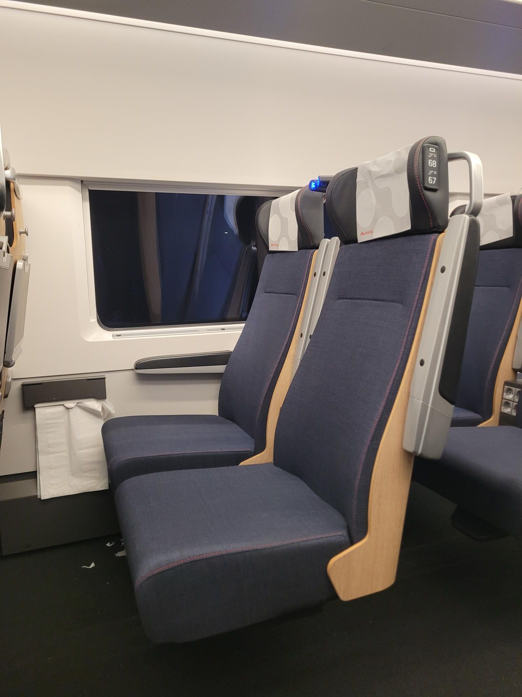

+++
title = "Not 30 seconds too soon"
description = "Ride — 2025-12-01"
date = 2025-12-01
authors = ["Max Katz-Christy"]

[taxonomies]
tags = ["Ride"]

[extra]
banner = "banner.jpg"
strava_id = 16619731979
distance_fmt = "12.27 km"
moving_time_fmt = "41m 42s"
elevation_gain_fmt = "122 m"
+++

And I was husling since the minute I came up with the plan lol

Took no pictures, but look at these nice swedish seats. They're comfy too

## Stats

| | |
|---|---|
| **Distance** | 12.27 km |
| **Moving time** | 41m 42s |
| **Elapsed time** | 41m 42s |
| **Elevation gain** | 122 m |
| **Average speed** | 17.6 km/h |
| **Max speed** | 36.3 km/h |
| **Calories** | 368 kcal |
| **Device** | Garmin fēnix 6X |

## Route

{{ strava_map() }}

[View on Strava](https://www.strava.com/activities/16619731979)

## Photos

