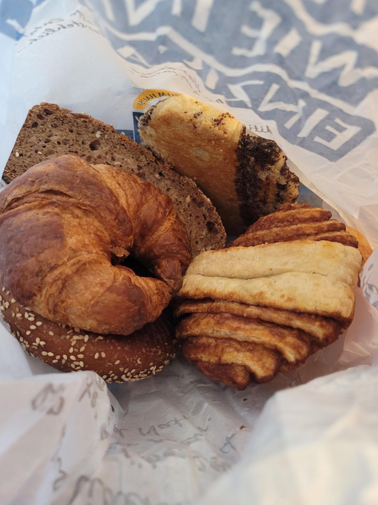

+++
title = "German cop running a red light"
description = "Run — 2025-12-10"
date = 2025-12-10
authors = ["Max Katz-Christy"]

[taxonomies]
tags = ["Run"]

[extra]
banner = "banner.jpg"
strava_id = 16700863298
distance_fmt = "0.99 km"
moving_time_fmt = "5m 26s"
elevation_gain_fmt = "9 m"
+++

Almost got run down on my way to my 5 min walk TGTG at a 14 min Hamburg transfer. I admit I wasn't perfectly awake, but I had the crosswalk.

Never run for DB... Let DB run late for you.

The caveat is when you are trying to catch the impossible earlier train...

On my way to visit my new job in Freiburg!

## Stats

| | |
|---|---|
| **Distance** | 0.99 km |
| **Moving time** | 5m 26s |
| **Elapsed time** | 7m 37s |
| **Elevation gain** | 9 m |
| **Average pace** | 5:30 /km |
| **Best pace** | 2:10 /km |
| **Average cadence** | 84 rpm |
| **Calories** | 80 kcal |
| **Device** | Garmin fēnix 6X |

## Route

{{ strava_map() }}

[View on Strava](https://www.strava.com/activities/16700863298)

## Photos

