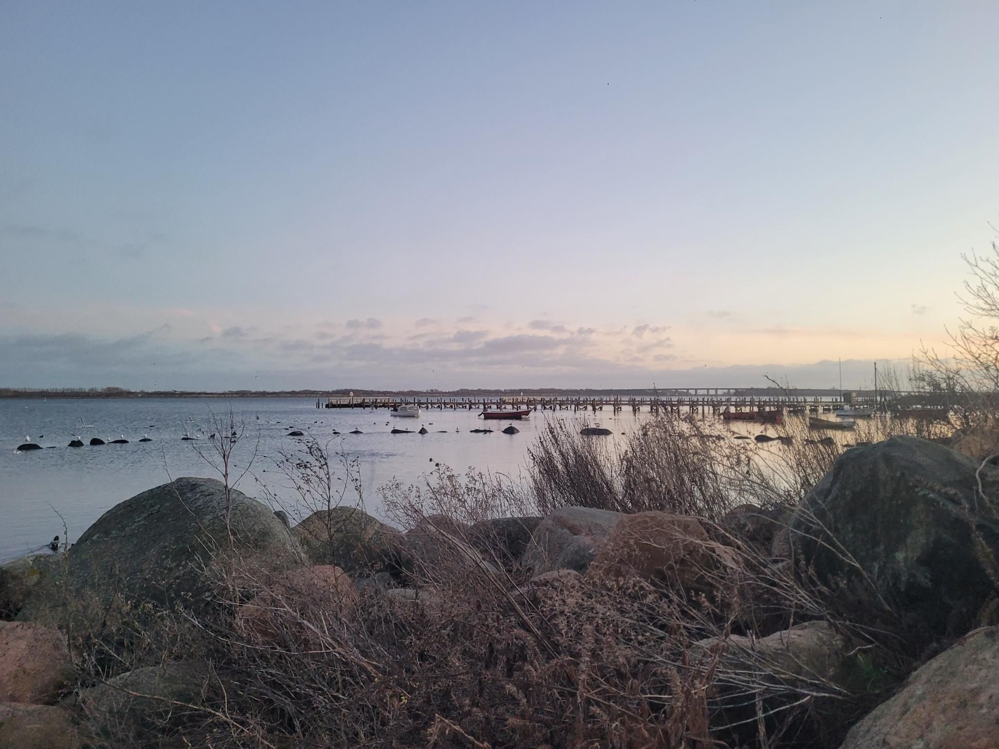

+++
title = "Fetching dinner"
description = "Run — 2025-12-13"
date = 2025-12-13
authors = ["Max Katz-Christy"]

[taxonomies]
tags = ["Run"]

[extra]
banner = "banner.jpg"
strava_id = 16732648523
distance_fmt = "20.26 km"
moving_time_fmt = "2h 10m 15s"
elevation_gain_fmt = "74 m"
+++

Every tgtg could be my last in CPH 😓 but I'm trying not to think about it. Joined virtually by Nina Katz-Christy !

## Stats

| | |
|---|---|
| **Distance** | 20.26 km |
| **Moving time** | 2h 10m 15s |
| **Elapsed time** | 2h 16m 02s |
| **Elevation gain** | 74 m |
| **Average pace** | 6:25 /km |
| **Best pace** | 2:04 /km |
| **Average cadence** | 76 rpm |
| **Calories** | 1518 kcal |
| **Achievements** | 2 |
| **Device** | Garmin fēnix 6X |

## Route

{{ strava_map() }}

[View on Strava](https://www.strava.com/activities/16732648523)

## Photos

