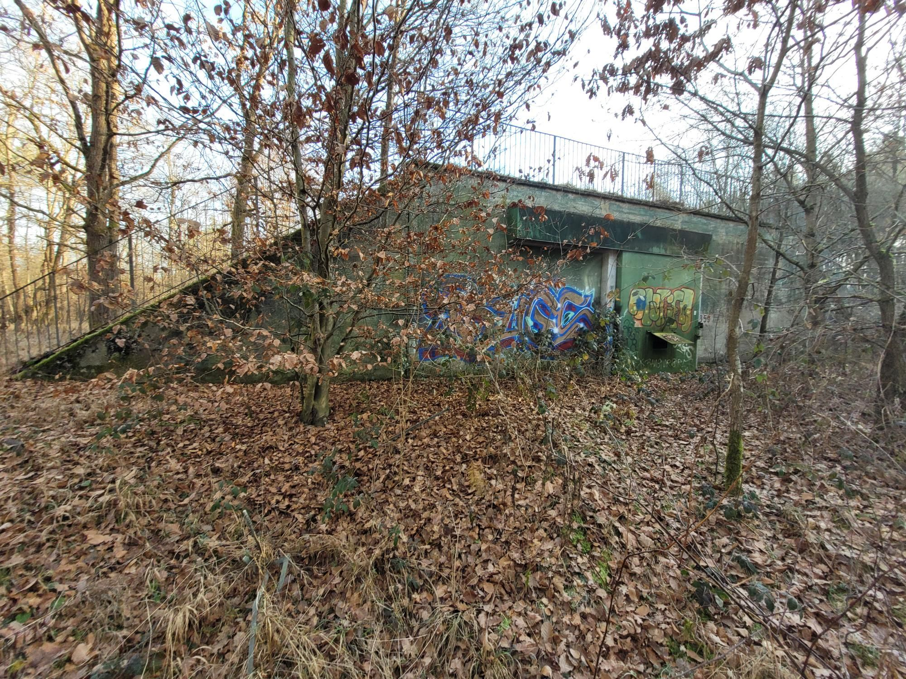

+++
title = "If we put as much effort into building housing in the us as we did building bunkers in Germany..."
description = "Run — 2025-12-27"
date = 2025-12-27
authors = ["Max Katz-Christy"]

[taxonomies]
tags = ["Run"]

[extra]
banner = "banner.jpg"
strava_id = 16852507038
distance_fmt = "13.67 km"
moving_time_fmt = "1h 20m 55s"
elevation_gain_fmt = "28 m"
+++

Apparently they throw bunker raves 🎉

## Stats

| | |
|---|---|
| **Distance** | 13.67 km |
| **Moving time** | 1h 20m 55s |
| **Elapsed time** | 1h 24m 22s |
| **Elevation gain** | 28 m |
| **Average pace** | 5:55 /km |
| **Best pace** | 2:47 /km |
| **Average cadence** | 81 rpm |
| **Calories** | 1039 kcal |
| **Device** | Garmin fēnix 6X |

## Route

{{ strava_map() }}

[View on Strava](https://www.strava.com/activities/16852507038)

## Photos

