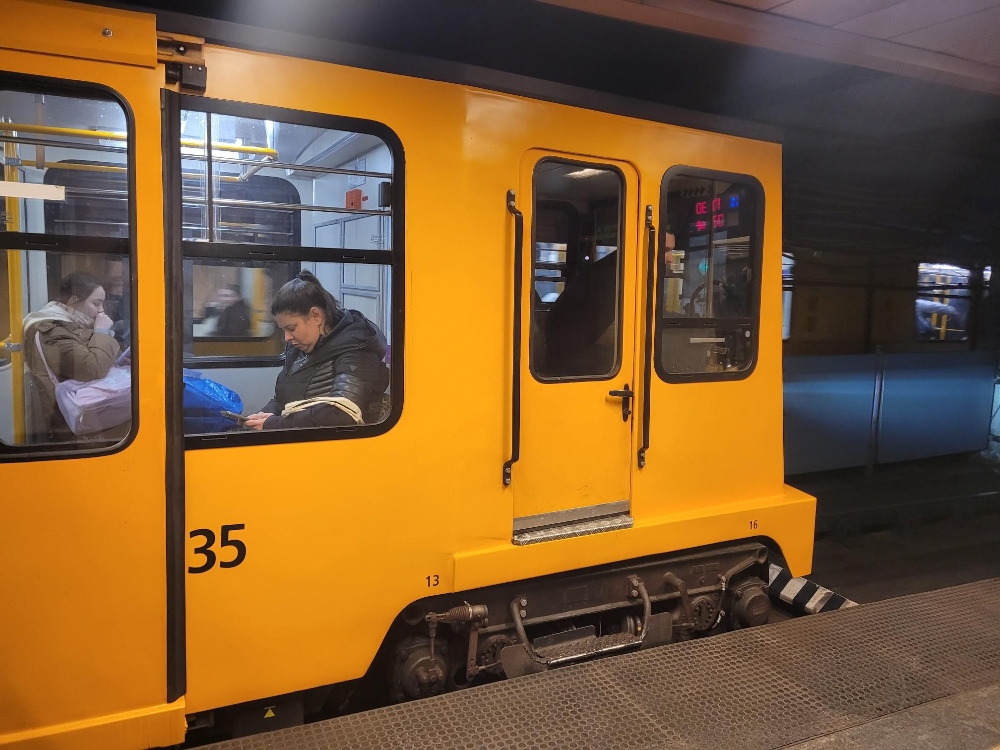

+++
title = "Another day, another run club"
description = "Run — 2026-01-07"
date = 2026-01-07
authors = ["Max Katz-Christy"]

[taxonomies]
tags = ["Run"]

[extra]
banner = "banner.jpg"
strava_id = 16971006122
distance_fmt = "6.69 km"
moving_time_fmt = "36m 35s"
elevation_gain_fmt = "25 m"
+++

Maybe a bit more Instagram focused than I would have liked, felt a little out of place running in jeans, allbirds, and a sweater. Didn't take any pics so please enjoy some random city pics. Cool train huh?

## Stats

| | |
|---|---|
| **Distance** | 6.69 km |
| **Moving time** | 36m 35s |
| **Elapsed time** | 39m 21s |
| **Elevation gain** | 25 m |
| **Average pace** | 5:28 /km |
| **Best pace** | 3:39 /km |
| **Average cadence** | 83 rpm |
| **Calories** | 517 kcal |
| **Device** | Garmin fēnix 6X |

## Route

{{ strava_map() }}

[View on Strava](https://www.strava.com/activities/16971006122)

## Photos

