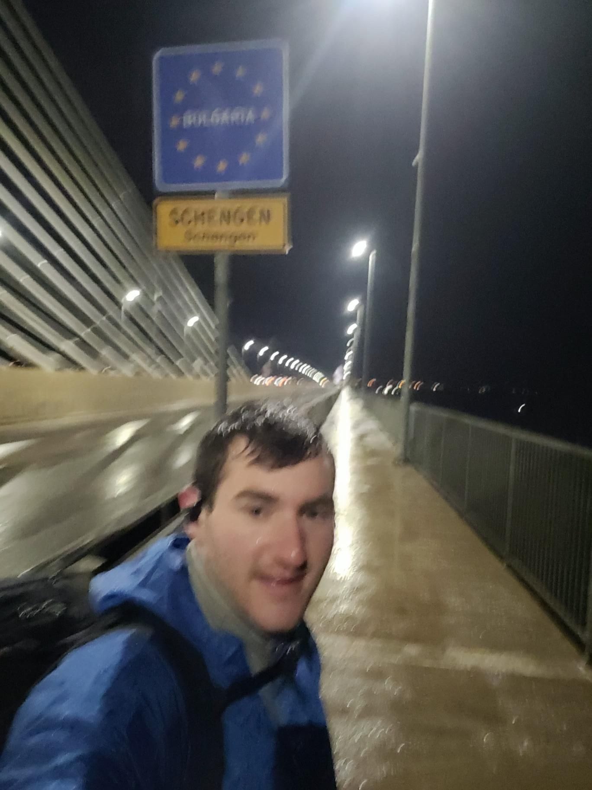

+++
title = "Almost dropped my passport in the Danube"
description = "Walk — 2026-01-09"
date = 2026-01-09
authors = ["Max Katz-Christy"]

[taxonomies]
tags = ["Walk"]

[extra]
banner = "banner.jpg"
strava_id = 16993857527
distance_fmt = "16.69 km"
moving_time_fmt = "3h 11m 47s"
elevation_gain_fmt = "71 m"
+++

The trains have gotten significantly sketchier.
The night train from Budapest was quite eventful. A substitute train first brought us to the middle of nowhere where our three night carriages were waiting. These carriages had no power and no locomotive, so we waited inside them listening in on the not so authoritative man who I assumed to be the conductor's phone calls with various people. During one such phone call, a woman crossed herself which I took to mean we'd be there a while. The locomotive did eventually come, and I woke up at 4:15 ready to disembark. However, we had barely moved. We were crawling along and it looked like there were fireworks outside. My guess is that the overhead wires were frozen, causing us to crawl and spark like crazy.
We racked up 10h of delays before reaching Craiova, missing my transfer to Bulgaria by a mile. Fortunately, DB suggested a clever route where I go to the last stop, right before the border, and take a taxi. Instead of finding a taxi, I took one of the strangest walks I've ever been on.
They built a very nice sidewalk into the bridge. I appreciated this, but so did the truck drivers who needed to take a dookie. The loopdie loops also felt a little unnecessary, but there were no ways around them. When I got close to Vidin, it turned to dirt, with trash strewn left and right. The chorus of dogs barking added to the ambiance of the evening. In Vidin, I thought going into the walled area might give me some late night tourism, but instead I just mutually spooked some teenagers having a smoke and found myself escaping through a hole in a fence.
Bis später und gute Nacht!

## Stats

| | |
|---|---|
| **Distance** | 16.69 km |
| **Moving time** | 3h 11m 47s |
| **Elapsed time** | 3h 34m 44s |
| **Elevation gain** | 71 m |
| **Average pace** | 11:29 /km |
| **Best pace** | 5:01 /km |
| **Average cadence** | 58 rpm |
| **Calories** | 1188 kcal |
| **Device** | Garmin fēnix 6X |

## Route

{{ strava_map() }}

[View on Strava](https://www.strava.com/activities/16993857527)

## Photos

