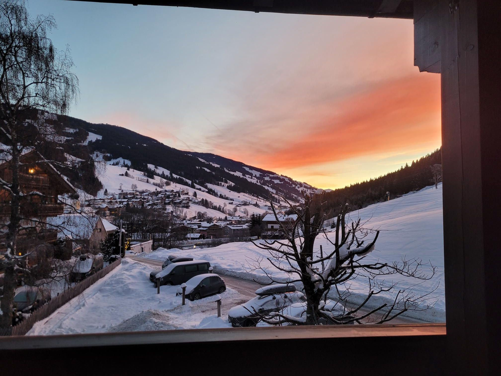

+++
title = "Skiing with the Heitkoetters"
description = "AlpineSki — 2026-01-14"
date = 2026-01-14
authors = ["Max Katz-Christy"]

[taxonomies]
tags = ["AlpineSki"]

[extra]
banner = "banner.jpg"
strava_id = 17047961321
distance_fmt = "56.45 km"
moving_time_fmt = "2h 34m 56s"
elevation_gain_fmt = "219 m"
+++

Sans Julius

## Stats

| | |
|---|---|
| **Distance** | 56.45 km |
| **Moving time** | 2h 34m 56s |
| **Elapsed time** | 6h 40m 41s |
| **Elevation gain** | 219 m |
| **Average speed** | 21.9 km/h |
| **Max speed** | 64.0 km/h |
| **Calories** | 2022 kcal |
| **Achievements** | 4 |
| **Device** | Garmin fēnix 6X |

## Route

{{ strava_map() }}

[View on Strava](https://www.strava.com/activities/17047961321)

## Photos

