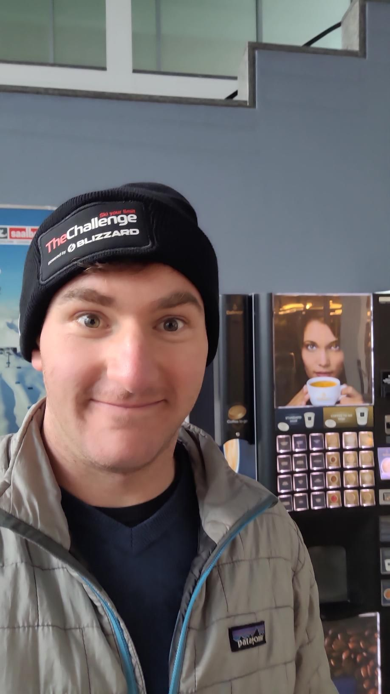

+++
title = "I joined the circus 🤡"
description = "AlpineSki — 2026-01-16"
date = 2026-01-16
authors = ["Max Katz-Christy"]

[taxonomies]
tags = ["AlpineSki"]

[extra]
banner = "banner.jpg"
strava_id = 17069706486
distance_fmt = "70.09 km"
moving_time_fmt = "2h 26m 07s"
elevation_gain_fmt = "362 m"
+++

Haha you got suckered by another of my clickbait titles. I did "The Challenge" aka the Saalbach skicircus. Met lots of people on the way. I had just lost my hat so I was happy to receive another! Fun way to ski a resort

## Stats

| | |
|---|---|
| **Distance** | 70.09 km |
| **Moving time** | 2h 26m 07s |
| **Elapsed time** | 5h 59m 45s |
| **Elevation gain** | 362 m |
| **Average speed** | 28.8 km/h |
| **Max speed** | 79.3 km/h |
| **Calories** | 1789 kcal |
| **Achievements** | 32 |
| **Device** | Garmin fēnix 6X |

## Route

{{ strava_map() }}

[View on Strava](https://www.strava.com/activities/17069706486)

## Photos

