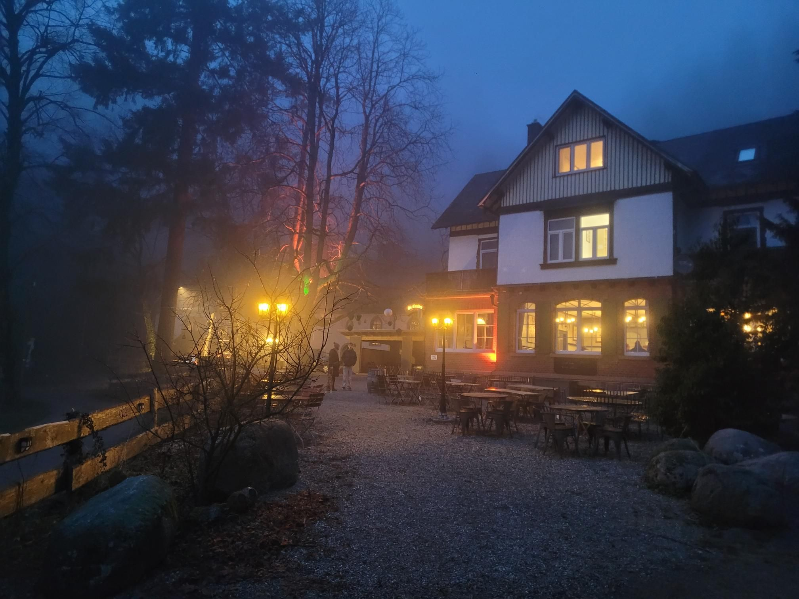

+++
title = "Moved in!"
description = "TrailRun — 2026-01-18"
date = 2026-01-18
authors = ["Max Katz-Christy"]

[taxonomies]
tags = ["TrailRun"]

[extra]
banner = "banner.jpg"
strava_id = 17095831893
distance_fmt = "12.97 km"
moving_time_fmt = "1h 30m 36s"
elevation_gain_fmt = "541 m"
+++

Come visit soon! Lots of forest to explore

## Stats

| | |
|---|---|
| **Distance** | 12.97 km |
| **Moving time** | 1h 30m 36s |
| **Elapsed time** | 1h 42m 18s |
| **Elevation gain** | 541 m |
| **Average pace** | 6:59 /km |
| **Best pace** | 3:20 /km |
| **Average cadence** | 74 rpm |
| **Calories** | 1031 kcal |
| **Device** | Garmin fēnix 6X |

## Route

{{ strava_map() }}

[View on Strava](https://www.strava.com/activities/17095831893)

## Photos

