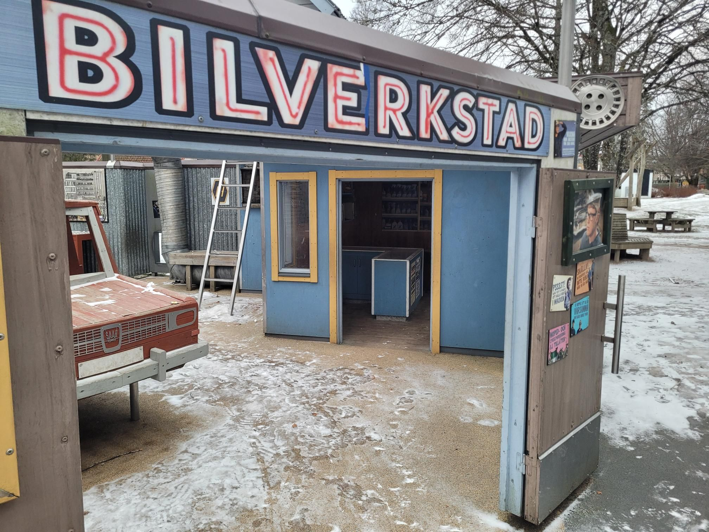

+++
title = "The art of the off-center transfer"
description = "Walk — 2026-01-23"
date = 2026-01-23
authors = ["Max Katz-Christy"]

[taxonomies]
tags = ["Walk"]

[extra]
banner = "banner.jpg"
strava_id = 17147611561
distance_fmt = "3.33 km"
moving_time_fmt = "39m 47s"
elevation_gain_fmt = "28 m"
+++

What's more valuable? 1h in a city or 1h in a small town? Assuming no cost to tickets, the I often prefer the later. Added bonuses are that you board your long distance train at a smaller station which can be less stressful. You also often get to ride another train! There are some drawbacks. If the train is slower it can cut into your transfer time and you might not have as good seating options.

I very much enjoyed exploring the little town, which included a very cool playground with a fun zipline (yes, I tested it and almost got stuck with my heavy backpack trying to get off with the ice).

Last night I happened to be in Copenhagen at the same time as Katherine Jankowski who was curious if she'd end up on my Strava

## Stats

| | |
|---|---|
| **Distance** | 3.33 km |
| **Moving time** | 39m 47s |
| **Elapsed time** | 46m 05s |
| **Elevation gain** | 28 m |
| **Average pace** | 11:56 /km |
| **Best pace** | 4:54 /km |
| **Average cadence** | 56 rpm |
| **Calories** | 262 kcal |
| **Device** | Garmin fēnix 6X |

## Route

{{ strava_map() }}

[View on Strava](https://www.strava.com/activities/17147611561)

## Photos

