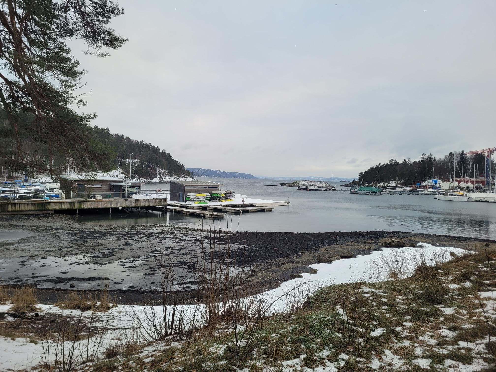

+++
title = "Whoops almost missed the Tog!"
description = "Walk — 2026-01-23"
date = 2026-01-23
authors = ["Max Katz-Christy"]

[taxonomies]
tags = ["Walk"]

[extra]
banner = "banner.jpg"
strava_id = 17150186357
distance_fmt = "6.36 km"
moving_time_fmt = "1h 12m 49s"
elevation_gain_fmt = "124 m"
+++

Had to hustle back, and then the train I was gonna take to my big train was running late. Fortunately they're all in one line. It's icy up here!

## Stats

| | |
|---|---|
| **Distance** | 6.36 km |
| **Moving time** | 1h 12m 49s |
| **Elapsed time** | 1h 16m 48s |
| **Elevation gain** | 124 m |
| **Average pace** | 11:26 /km |
| **Best pace** | 5:04 /km |
| **Average cadence** | 61 rpm |
| **Calories** | 472 kcal |
| **Device** | Garmin fēnix 6X |

## Route

{{ strava_map() }}

[View on Strava](https://www.strava.com/activities/17150186357)

## Photos

