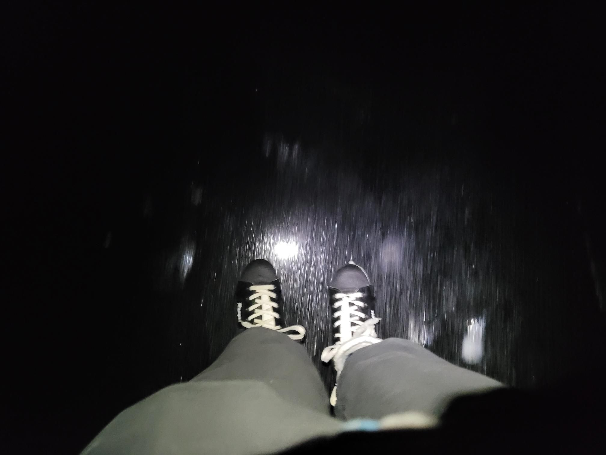

+++
title = "First day of ice in Stavanger!"
description = "IceSkate — 2026-01-26"
date = 2026-01-26
authors = ["Max Katz-Christy"]

[taxonomies]
tags = ["IceSkate"]

[extra]
banner = "banner.jpg"
strava_id = 17185965055
distance_fmt = "7.07 km"
moving_time_fmt = "56m 12s"
elevation_gain_fmt = "5 m"
+++

Very lucky timing! Jens Christian Ytre-Arne found me some skates and we enjoyed some beautiful black ice

## Stats

| | |
|---|---|
| **Distance** | 7.07 km |
| **Moving time** | 56m 12s |
| **Elapsed time** | 1h 08m 24s |
| **Elevation gain** | 5 m |
| **Average speed** | 7.5 km/h |
| **Max speed** | 22.9 km/h |
| **Calories** | 294 kcal |
| **Device** | Garmin fēnix 6X |

## Route

{{ strava_map() }}

[View on Strava](https://www.strava.com/activities/17185965055)

## Photos

