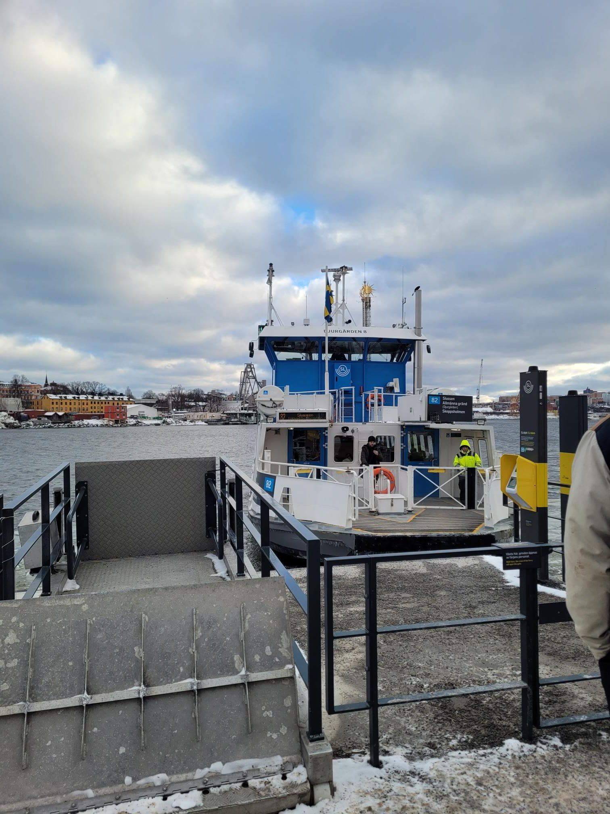

+++
title = "Ferry hopping to two too good to gos"
description = "Run — 2026-01-30"
date = 2026-01-30
authors = ["Max Katz-Christy"]

[taxonomies]
tags = ["Run"]

[extra]
banner = "banner.jpg"
strava_id = 17228146035
distance_fmt = "12.05 km"
moving_time_fmt = "1h 23m 16s"
elevation_gain_fmt = "105 m"
+++

Yeah Katherine Jankowski may have left it running on the trolley...

## Stats

| | |
|---|---|
| **Distance** | 12.05 km |
| **Moving time** | 1h 23m 16s |
| **Elapsed time** | 2h 24m 49s |
| **Elevation gain** | 105 m |
| **Average pace** | 6:54 /km |
| **Best pace** | 2:48 /km |
| **Average cadence** | 74 rpm |
| **Calories** | 1145 kcal |
| **Device** | Garmin fēnix 6X |

## Route

{{ strava_map() }}

[View on Strava](https://www.strava.com/activities/17228146035)

## Photos

