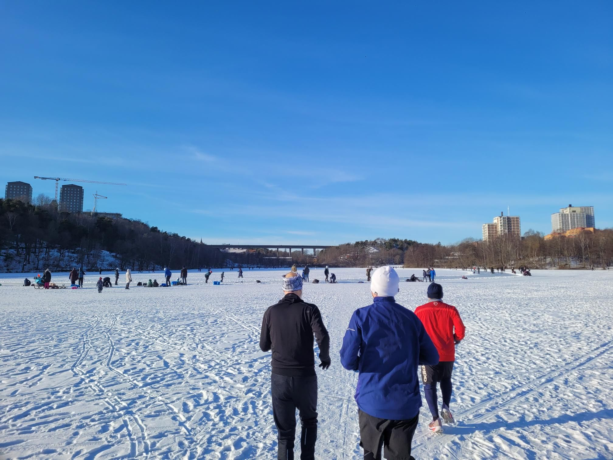

+++
title = "Feeling young again"
description = "Run — 2026-01-31"
date = 2026-01-31
authors = ["Max Katz-Christy"]

[taxonomies]
tags = ["Run"]

[extra]
banner = "banner.jpg"
strava_id = 17236508105
distance_fmt = "17.00 km"
moving_time_fmt = "1h 38m 36s"
elevation_gain_fmt = "94 m"
+++

Ran with three older men to a cafe. Then got some tgtg churros. Not a bad morning

## Stats

| | |
|---|---|
| **Distance** | 17.00 km |
| **Moving time** | 1h 38m 36s |
| **Elapsed time** | 2h 06m 41s |
| **Elevation gain** | 94 m |
| **Average pace** | 5:48 /km |
| **Best pace** | 3:03 /km |
| **Average cadence** | 84 rpm |
| **Calories** | 1253 kcal |
| **Achievements** | 2 |
| **Device** | Garmin fēnix 6X |

## Route

{{ strava_map() }}

[View on Strava](https://www.strava.com/activities/17236508105)

## Photos

