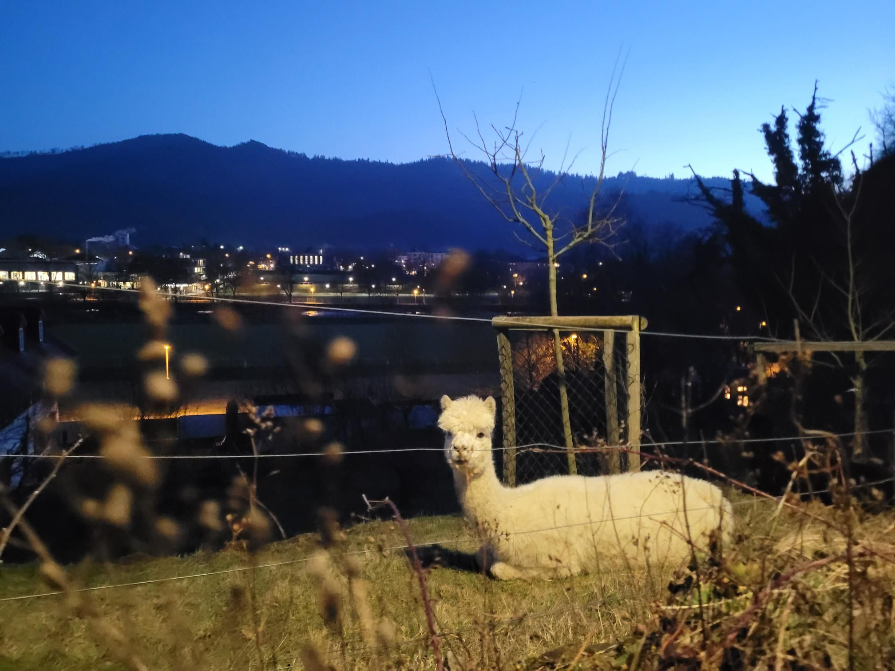

+++
title = "Met the guy who made "
description = "Run — 2026-02-09"
date = 2026-02-09
authors = ["Max Katz-Christy"]

[taxonomies]
tags = ["Run"]

[extra]
banner = "banner.jpg"
strava_id = 17341917096
distance_fmt = "12.34 km"
moving_time_fmt = "1h 11m 59s"
elevation_gain_fmt = "86 m"
+++

Ryzen run club. We did some interesting stuff at the beginning, but it was very social. I really gotta learn German

## Stats

| | |
|---|---|
| **Distance** | 12.34 km |
| **Moving time** | 1h 11m 59s |
| **Elapsed time** | 1h 26m 18s |
| **Elevation gain** | 86 m |
| **Average pace** | 5:50 /km |
| **Best pace** | 2:37 /km |
| **Average cadence** | 80 rpm |
| **Calories** | 972 kcal |
| **Achievements** | 1 |
| **Device** | Garmin fēnix 6X |

## Route

{{ strava_map() }}

[View on Strava](https://www.strava.com/activities/17341917096)

## Photos

