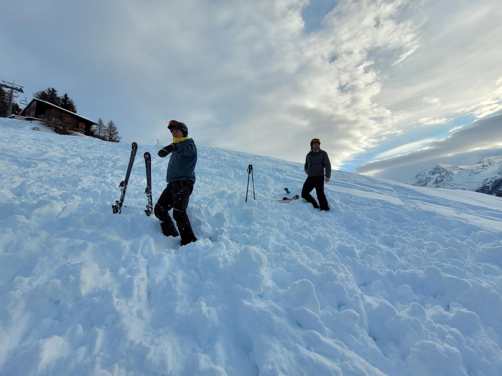

+++
title = "The absolute last chair"
description = "AlpineSki — 2026-02-15"
date = 2026-02-15
authors = ["Max Katz-Christy"]

[taxonomies]
tags = ["AlpineSki"]

[extra]
banner = "banner.jpg"
strava_id = 17407903683
distance_fmt = "38.13 km"
moving_time_fmt = "1h 38m 52s"
elevation_gain_fmt = "226 m"
+++

There were no other chairs even hooked onto the cable because they were disconnecting them that night.

One of us wiped out and lost one ski in some off Piste spot so we spent 30 minutes hunting for it. Then the lift closed and we were in some faraway spot. The very Swiss lift operator first turned us away but eventually took pity on us. They were removing the chairs for the night, so they let us ride up facing backwards, the lift running in reverse, on the very last chair still connected. Very special experience.

Also had a huge amount of proper Swiss Raclette last night. Fun weekend!

## Stats

| | |
|---|---|
| **Distance** | 38.13 km |
| **Moving time** | 1h 38m 52s |
| **Elapsed time** | 6h 41m 21s |
| **Elevation gain** | 226 m |
| **Average speed** | 23.1 km/h |
| **Max speed** | 82.9 km/h |
| **Calories** | 1659 kcal |
| **Achievements** | 26 |
| **Device** | Garmin fēnix 6X |

## Route

{{ strava_map() }}

[View on Strava](https://www.strava.com/activities/17407903683)

## Photos

