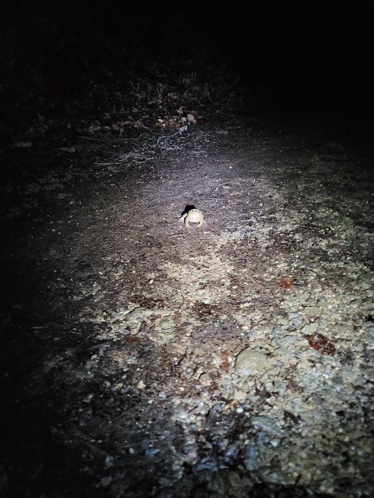

+++
title = "I went up the MTB trail 🤫"
description = "TrailRun — 2026-02-21"
date = 2026-02-21
authors = ["Max Katz-Christy"]

[taxonomies]
tags = ["TrailRun"]

[extra]
banner = "banner.jpg"
strava_id = 17476457345
distance_fmt = "22.64 km"
moving_time_fmt = "2h 46m 02s"
elevation_gain_fmt = "547 m"
+++

Didn't get caught but still felt like an Ausländer 😬

I've been trying to complete a checklist all day but it keeps getting longer 🤦‍♂️. Tgtg related content is on its way to the fediverse...

Walton Rea how'd I do with the frog pic? I sorta tried to do one of your classics, but while I was crouching down, buddy was hopping off so I kinda missed both of us 😔

Today I was picking up some too good to go kombucha at a local brewery and on my way out, I stumbled into the local historic trolley car maintenance facility (notably not a museum, but repairing and maintaining the old vehicles (though effectively a museum)). After explaining in broken German that I don't speak German to the man who had found me snooping in the window, I was passed off to two kids who were almost ten years younger than me. They gave me a very comprehensive tour of the facility, which devolved into discussions about various railroad technology all over the world.

## Stats

| | |
|---|---|
| **Distance** | 22.64 km |
| **Moving time** | 2h 46m 02s |
| **Elapsed time** | 3h 10m 46s |
| **Elevation gain** | 547 m |
| **Average pace** | 7:19 /km |
| **Best pace** | 3:07 /km |
| **Average cadence** | 68 rpm |
| **Calories** | 1717 kcal |
| **Achievements** | 18 |
| **Device** | Garmin fēnix 6X |

## Route

{{ strava_map() }}

[View on Strava](https://www.strava.com/activities/17476457345)

## Photos

