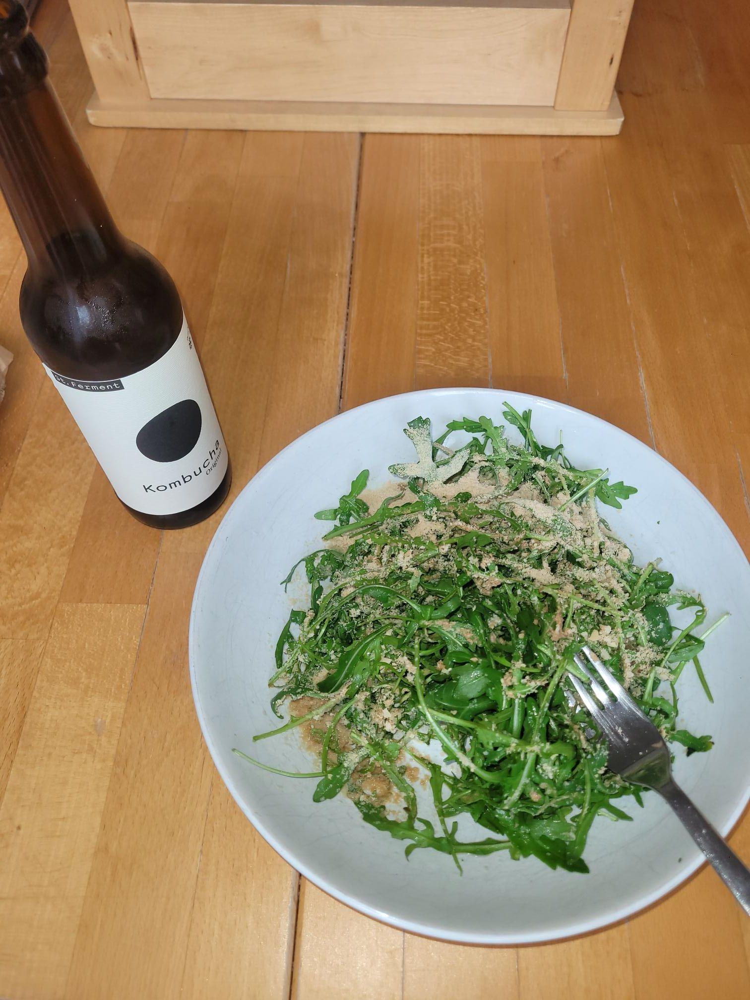

+++
title = "TGTG Kombucha"
description = "Run — 2026-02-22"
date = 2026-02-22
authors = ["Max Katz-Christy"]

[taxonomies]
tags = ["Run"]

[extra]
banner = "banner.jpg"
strava_id = 17482522345
distance_fmt = "8.40 km"
moving_time_fmt = "49m 32s"
elevation_gain_fmt = "52 m"
+++

I think this will become a staple for me. Also look I went shopping!

## Stats

| | |
|---|---|
| **Distance** | 8.40 km |
| **Moving time** | 49m 32s |
| **Elapsed time** | 1h 08m 12s |
| **Elevation gain** | 52 m |
| **Average pace** | 5:53 /km |
| **Best pace** | 3:22 /km |
| **Average cadence** | 81 rpm |
| **Calories** | 695 kcal |
| **Device** | Garmin fēnix 6X |

## Route

{{ strava_map() }}

[View on Strava](https://www.strava.com/activities/17482522345)

## Photos

