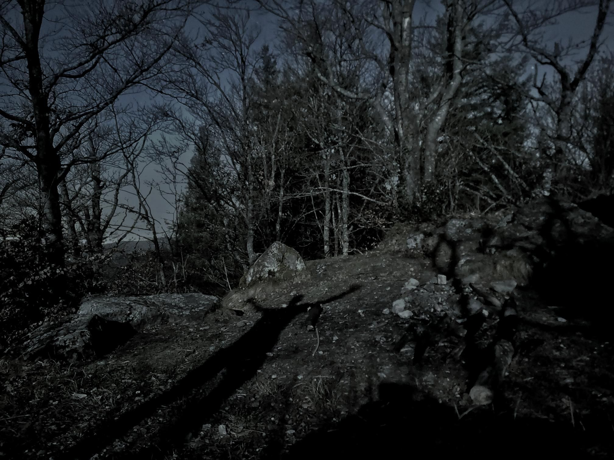

+++
title = "Moonshadow"
description = "TrailRun — 2026-03-02"
date = 2026-03-02
authors = ["Max Katz-Christy"]

[taxonomies]
tags = ["TrailRun"]

[extra]
banner = "banner.jpg"
strava_id = 17579868085
distance_fmt = "16.39 km"
moving_time_fmt = "1h 58m 19s"
elevation_gain_fmt = "652 m"
+++

Finished listening to braiding Sweetgrass! Fantastic book, which I highly recommend to those looking for a more personal approach to the abundance mindset. 

Also, if you want to pretend to be a bus driver and help test "a public option for realtime GTFS" I've been working on, lmk. Maybe soon it'll be released on my blog. 

Speaking of which, if you GIS and food, check out my first post here: https://max.kcfam.us/blog/mapping-tgtg

Three shameless plugs but whatever, not too many of you will read this anyways.

Regarding the run, to balance things out, it was very nice! I'm really liking this place. Shorts and a T shirt at night in March 🤯

## Stats

| | |
|---|---|
| **Distance** | 16.39 km |
| **Moving time** | 1h 58m 19s |
| **Elapsed time** | 2h 23m 02s |
| **Elevation gain** | 652 m |
| **Average pace** | 7:13 /km |
| **Best pace** | 2:53 /km |
| **Average cadence** | 70 rpm |
| **Calories** | 1313 kcal |
| **Achievements** | 3 |
| **Device** | Garmin fēnix 6X |

## Route

{{ strava_map() }}

[View on Strava](https://www.strava.com/activities/17579868085)

## Photos

