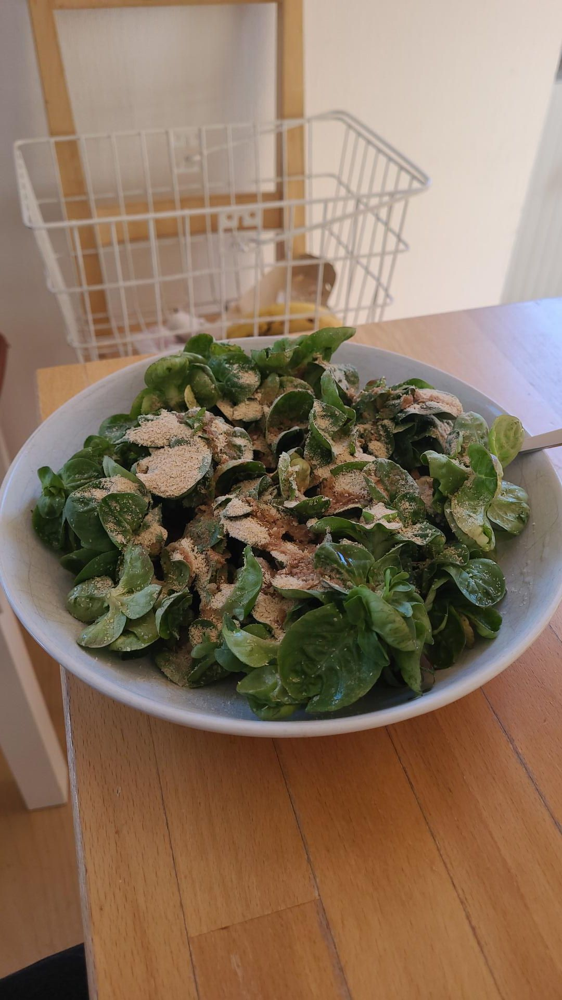

+++
title = "750g Feldsalat (sheep lettuce)"
description = "Run — 2026-03-03"
date = 2026-03-03
authors = ["Max Katz-Christy"]

[taxonomies]
tags = ["Run"]

[extra]
banner = "banner.jpg"
strava_id = 17592761602
distance_fmt = "17.59 km"
moving_time_fmt = "1h 38m 04s"
elevation_gain_fmt = "143 m"
+++

From a farmers marker but on too good to go... Interesting. Also got a new lens for my camera! Still figuring it out, but some night shots from my appt.

Oh yeah and I went on the long group run! Everyone is named Florian here. A Florian will be emailing me back when he wants to do a long run to France👍

## Stats

| | |
|---|---|
| **Distance** | 17.59 km |
| **Moving time** | 1h 38m 04s |
| **Elapsed time** | 1h 52m 37s |
| **Elevation gain** | 143 m |
| **Average pace** | 5:34 /km |
| **Best pace** | 2:07 /km |
| **Average cadence** | 80 rpm |
| **Calories** | 1294 kcal |
| **Achievements** | 11 |
| **Device** | Garmin fēnix 6X |

## Route

{{ strava_map() }}

[View on Strava](https://www.strava.com/activities/17592761602)

## Photos

