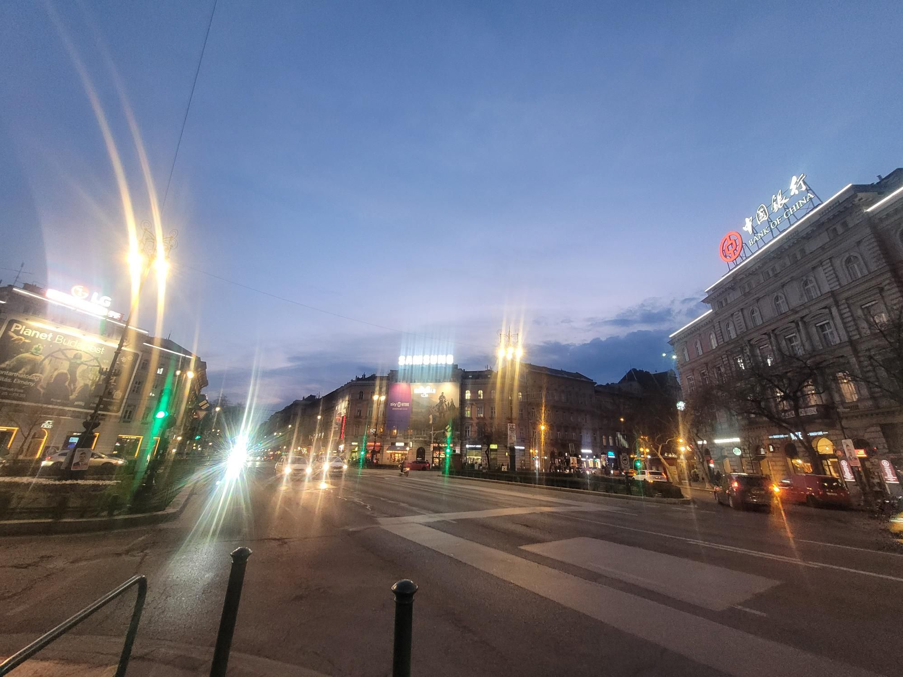

+++
title = "The Spencer route"
description = "Run — 2026-03-16"
date = 2026-03-16
authors = ["Max Katz-Christy"]

[taxonomies]
tags = ["Run"]

[extra]
banner = "banner.jpg"
strava_id = 17744099558
distance_fmt = "7.41 km"
moving_time_fmt = "37m 30s"
elevation_gain_fmt = "15 m"
+++

"Reminds me of the Hudson"

So many things here feel the same as every other big European city... You have to look a little closer to see the differences. I don't think you'd find the set of rooftop signs you see here in NYC

## Stats

| | |
|---|---|
| **Distance** | 7.41 km |
| **Moving time** | 37m 30s |
| **Elapsed time** | 39m 17s |
| **Elevation gain** | 15 m |
| **Average pace** | 5:03 /km |
| **Best pace** | 2:54 /km |
| **Average cadence** | 82 rpm |
| **Calories** | 530 kcal |
| **Device** | Garmin fēnix 6X |

## Route

{{ strava_map() }}

[View on Strava](https://www.strava.com/activities/17744099558)

## Photos

