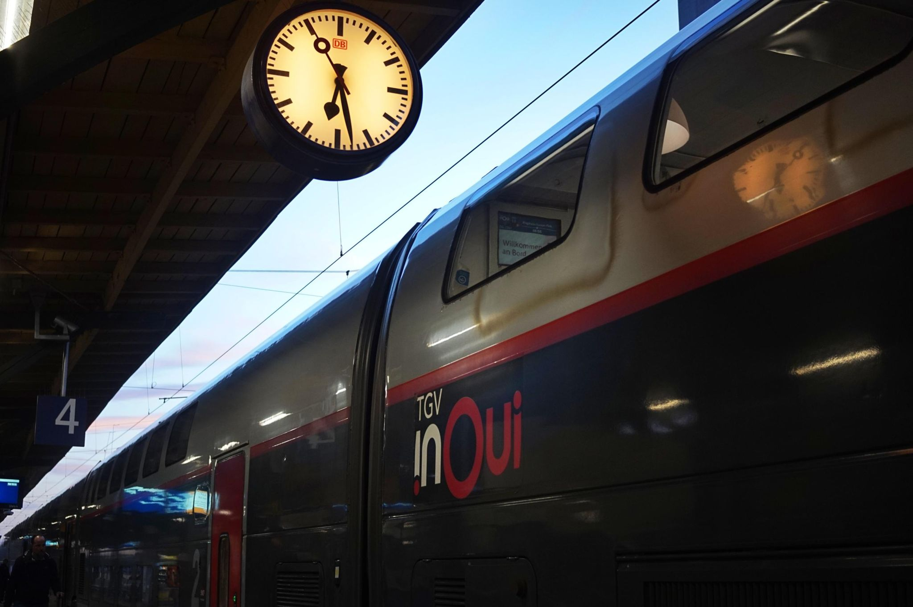

+++
title = "TGV in Freiburg"
description = "Ride — 2026-03-20"
date = 2026-03-20
authors = ["Max Katz-Christy"]

[taxonomies]
tags = ["Ride"]

[extra]
banner = "banner.jpg"
strava_id = 17790442201
distance_fmt = "5.92 km"
moving_time_fmt = "22m 43s"
elevation_gain_fmt = "43 m"
+++

Funny sight to see the TGV on the Freiburg platform on its way to Paris.

I've always steered away from Paris because it's a bit touristy, but holy smokes it's pretty. More pics soon, after work and some adventures. These were just this morning.

## Stats

| | |
|---|---|
| **Distance** | 5.92 km |
| **Moving time** | 22m 43s |
| **Elapsed time** | 23m 43s |
| **Elevation gain** | 43 m |
| **Average speed** | 15.6 km/h |
| **Max speed** | 38.7 km/h |
| **Calories** | 185 kcal |
| **Device** | Garmin fēnix 6X |

## Route

{{ strava_map() }}

[View on Strava](https://www.strava.com/activities/17790442201)

## Photos

