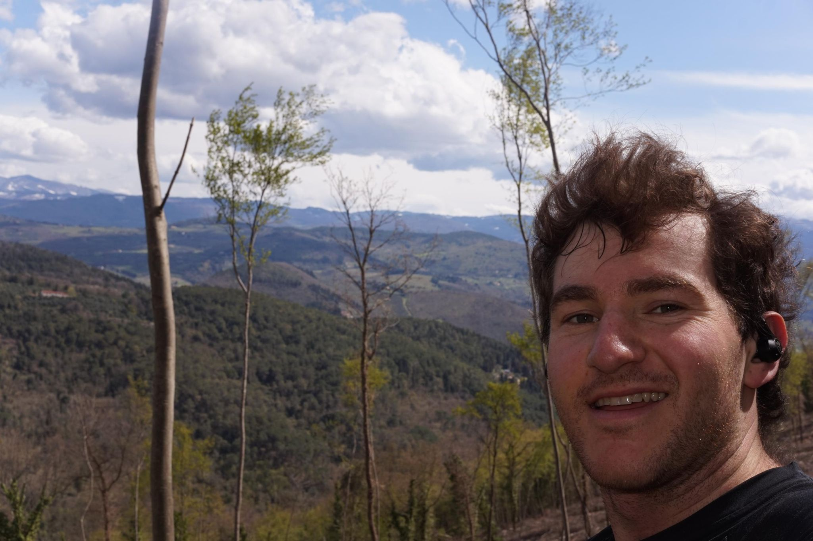

+++
title = "A regional train-ridgeline-regional train sandwich"
description = "TrailRun — 2026-03-31"
date = 2026-03-31
authors = ["Max Katz-Christy"]

[taxonomies]
tags = ["TrailRun"]

[extra]
banner = "banner.jpg"
strava_id = 17925571281
distance_fmt = "18.97 km"
moving_time_fmt = "2h 44m 15s"
elevation_gain_fmt = "838 m"
+++

Took the regional train east this time, then ran along a beautiful ridgeline to another regional line back to the city! 

I encountered two dogs today, milling about on the trail, no owner in sight. Most likely, I was scared for absolutely no reason. However, they did enjoy chasing me and growling much more than I did. Reminded me a bit of eastern Kentucky.

It's absolutely wild that you can see snow in the mountains from a place as warm as Florence. I again ran fast for the train, but this time I was a few minutes early. An old woman helped me find the correct track. She and a younger woman on the track started chatting. The old woman gave me intergalactic sign language for "aren't you cold". I responded with my usual quip, "I'm from Boston". Then the girl drops the Italian and says, well I'm from NY and I'm still chilly in this breeze. Busted. 

A crowd of kids boarded the train on their way into the city. I wonder what it must be like to grow up there. Do they commute out of the city for school and live downtown? Do they come for afternoon activities? Did they just finish their home lunch and are coming into the city for evening classes?

## Stats

| | |
|---|---|
| **Distance** | 18.97 km |
| **Moving time** | 2h 44m 15s |
| **Elapsed time** | 3h 40m 51s |
| **Elevation gain** | 838 m |
| **Average pace** | 8:39 /km |
| **Best pace** | 2:43 /km |
| **Average cadence** | 73 rpm |
| **Calories** | 1695 kcal |
| **Device** | Garmin fēnix 6X |

## Route

{{ strava_map() }}

[View on Strava](https://www.strava.com/activities/17925571281)

## Photos

