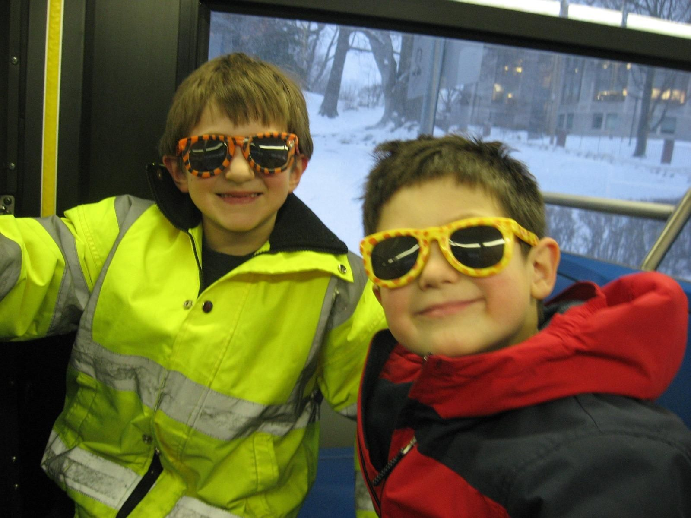

+++
title = "Met a guy named Finn!"
description = "Run — 2026-04-26"
date = 2026-04-26
authors = ["Max Katz-Christy"]

[taxonomies]
tags = ["Run"]

[extra]
banner = "banner.jpg"
strava_id = 18264691209
distance_fmt = "8.36 km"
moving_time_fmt = "50m 20s"
elevation_gain_fmt = "52 m"
+++

This isn't him and me, but me and my friend from elementary school, Finn. Also, a picture someone uploaded of my cat to his website.

Managed to get through this run despite a large bruise from yesterday. It's no longer egg shaped and has flattened out a bit. Gotta get a bit of work done, then practice unicycling for tomorrow before movie night with my roommates!

## Stats

| | |
|---|---|
| **Distance** | 8.36 km |
| **Moving time** | 50m 20s |
| **Elapsed time** | 1h 18m 30s |
| **Elevation gain** | 52 m |
| **Average pace** | 6:01 /km |
| **Best pace** | 3:02 /km |
| **Average cadence** | 81 rpm |
| **Calories** | 707 kcal |
| **Device** | Garmin fēnix 6X |

## Route

{{ strava_map() }}

[View on Strava](https://www.strava.com/activities/18264691209)

## Photos

