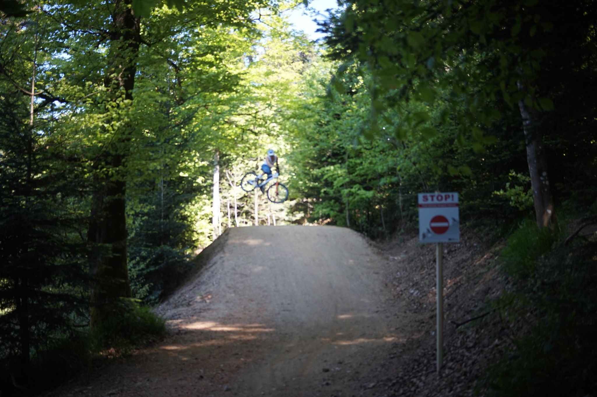

+++
title = "DH MTB is scary"
description = "MountainBikeRide — 2026-05-01"
date = 2026-05-01
authors = ["Max Katz-Christy"]

[taxonomies]
tags = ["MountainBikeRide"]

[extra]
banner = "banner.jpg"
strava_id = 18333130327
distance_fmt = "20.17 km"
moving_time_fmt = "1h 26m 02s"
elevation_gain_fmt = "587 m"
+++

I did most of the Baden to the Bone trail. It is not easy. Maybe I need to get more sendy?

Super cool that I can be on top of Rosskopf from my house in less than an hour and then ride down multiple different MTB trails.

## Stats

| | |
|---|---|
| **Distance** | 20.17 km |
| **Moving time** | 1h 26m 02s |
| **Elapsed time** | 1h 43m 44s |
| **Elevation gain** | 587 m |
| **Average speed** | 14.1 km/h |
| **Max speed** | 52.0 km/h |
| **Calories** | 883 kcal |
| **Achievements** | 10 |
| **Device** | Garmin fēnix 6X |

## Route

{{ strava_map() }}

[View on Strava](https://www.strava.com/activities/18333130327)

## Photos

